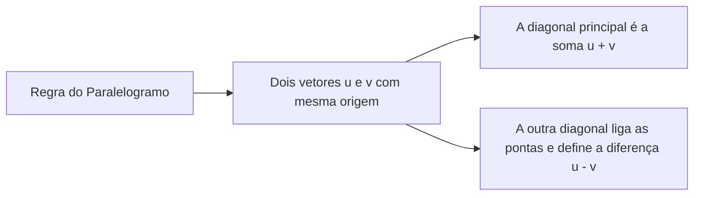

# Capítulo 1: Vetores e Operações Fundamentais no Espaço

Os vetores constituem a linguagem geométrica fundamental da física e da engenharia elétrica. Conceitos como campo elétrico ($\vec{E}$), campo magnético ($\vec{B}$), forças eletromecânicas e fasores de tensão/corrente são todos construídos a partir da álgebra vetorial no $\mathbb{R}^2$ e $\mathbb{R}^3$.

---

## 1. Definição Geométrica e Algébrica de Vetor

Um vetor geométrico $\vec{v}$ no espaço euclidiano tridimensional ($\mathbb{R}^3$) é caracterizado por:
1. **Módulo (Norma, $\|\vec{v}\|$):** Comprimento escalar do segmento orientado.
2. **Direção:** Reta suporte sobre a qual o vetor repousa.
3. **Sentido:** Orientação do ponto de origem ao ponto de extremidade.

Algebricamente, dado um sistema de coordenadas ortonormais com vetores unitários da base canônica $\hat{i}, \hat{j}, \hat{k}$:

$$
\vec{v} = v_x \hat{i} + v_y \hat{j} + v_z \hat{k} = (v_x, v_y, v_z)
$$

O módulo de $\vec{v}$ é dado por:

$$
\|\vec{v}\| = \sqrt{v_x^2 + v_y^2 + v_z^2}
$$

---

## 2. Operações Básicas: Adição e Subtração

### 2.1 Adição de Vetores
Geometricamente obtida pela **Regra do Polígono** (origem de um na ponta do outro) ou pela **Regra do Paralelogramo**:

Algebricamente:

$$
\vec{u} + \vec{v} = (u_x + v_x, u_y + v_y, u_z + v_z)
$$

Pela lei dos cossenos aplicada ao paralelogramo de lados $\|\vec{u}\|$ e $\|\vec{v}\|$ com ângulo $\theta$ entre eles:

$$
\|\vec{u} + \vec{v}\|^2 = \|\vec{u}\|^2 + \|\vec{v}\|^2 + 2 \|\vec{u}\| \|\vec{v}\| \cos\theta
$$

---

### 2.2 Subtração de Vetores
A subtração nada mais é do que a soma com o vetor oposto (invertido):

$$
\vec{u} - \vec{v} = \vec{u} + (-\vec{v}) = (u_x - v_x, u_y - v_y, u_z - v_z)
$$

$$
\|\vec{u} - \vec{v}\|^2 = \|\vec{u}\|^2 + \|\vec{v}\|^2 - 2 \|\vec{u}\| \|\vec{v}\| \cos\theta
$$

---

## 3. Produto Escalar ($\vec{u} \cdot \vec{v}$)

O produto escalar (produto interno euclidiano) associa a dois vetores um **número escalar**:

### 3.1 Definição Geométrica

$$
\vec{u} \cdot \vec{v} = \|\vec{u}\| \|\vec{v}\| \cos\theta \quad (0 \le \theta \le \pi)
$$

### 3.2 Forma Cartesiana

$$
\vec{u} \cdot \vec{v} = u_x v_x + u_y v_y + u_z v_z
$$

### 3.3 Propriedades e Aplicações Principais:
1. **Ângulo entre dois vetores:**
   $$
   \cos\theta = \frac{\vec{u} \cdot \vec{v}}{\|\vec{u}\| \|\vec{v}\|}
   $$
2. **Critério de Ortogonalidade:** Dois vetores não nulos são perpendiculares se, e somente se, o produto escalar entre eles for nulo:
   $$
   \vec{u} \perp \vec{v} \iff \vec{u} \cdot \vec{v} = 0
   $$
3. **Projeção Ortogonal de $\vec{u}$ sobre $\vec{v}$:**
   $$
   \text{proj}_{\vec{v}}\vec{u} = \left(\frac{\vec{u} \cdot \vec{v}}{\|\vec{v}\|^2}\right) \vec{v}
   $$

---

## 4. Produto Vetorial ($\vec{u} \times \vec{v}$)

O produto vetorial associa a dois vetores tridimensionais um **terceiro vetor** com as seguintes características:
* **Direção:** Perpendicular ao plano gerado por $\vec{u}$ e $\vec{v}$ ($\vec{u} \times \vec{v} \perp \vec{u}$ e $\vec{u} \times \vec{v} \perp \vec{v}$).
* **Sentido:** Definido pela **Regra da Mão Direita** (dedos giram de $\vec{u}$ para $\vec{v}$, polegar aponta no sentido do produto).
* **Módulo:** Igual à área do paralelogramo formado por $\vec{u}$ e $\vec{v}$:
  $$
  \|\vec{u} \times \vec{v}\| = \|\vec{u}\| \|\vec{v}\| \operatorname{sen}\theta
  $$

### 4.1 Cálculo através do Determinante Simbólico:

$$
\vec{u} \times \vec{v} = \det \begin{bmatrix}
\hat{i} & \hat{j} & \hat{k} \\
u_x & u_y & u_z \\
v_x & v_y & v_z
\end{bmatrix} = (u_y v_z - u_z v_y)\hat{i} - (u_x v_z - u_z v_x)\hat{j} + (u_x v_y - u_y v_x)\hat{k}
$$

> [!WARNING] Não Comutatividade:
> O produto vetorial é **antissimétrico**: $\vec{u} \times \vec{v} = -(\vec{v} \times \vec{u})$.
> Além disso, dois vetores não nulos são paralelos se, e somente se, $\vec{u} \times \vec{v} = \vec{0}$.

---

## 5. Produto Misto $[\vec{u}, \vec{v}, \vec{w}]$

O produto misto combina produto vetorial e escalar para definir o volume de um paralelepípedo tridimensional:

$$
[\vec{u}, \vec{v}, \vec{w}] = \vec{u} \cdot (\vec{v} \times \vec{w}) = \det \begin{bmatrix}
u_x & u_y & u_z \\
v_x & v_y & v_z \\
w_x & w_y & w_z
\end{bmatrix}
$$

* O volume do paralelepípedo gerado pelos três vetores é $V = |[\vec{u}, \vec{v}, \vec{w}]|$.
* Se $[\vec{u}, \vec{v}, \vec{w}] = 0$, os três vetores são **coplanares** (pertencem ao mesmo plano).
