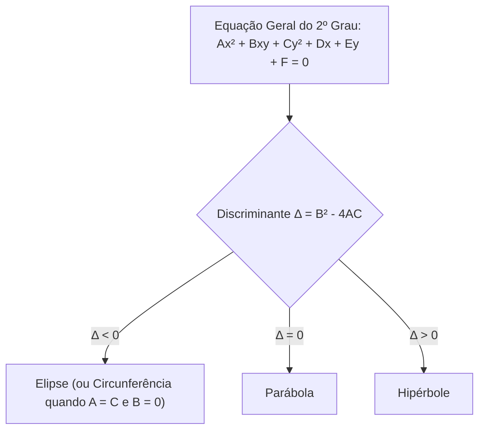

# Capítulo 2: Estudo Analítico das Seções Cônicas

As cônicas são curvas planas obtidas pela interseção de um cone circular reto de duas folhas com um plano secante. Elas descrevem órbitas de satélites, refletores parabólicos de antenas de telecomunicação e diagramas de fase em sistemas elétricos dinâmicos.

---

## 1. Classificação Geral e Equação Geral do 2º Grau

A equação geral do segundo grau em duas variáveis $x$ e $y$ é:

$$
A x^2 + B x y + C y^2 + D x + E y + F = 0
$$

O termo misto $Bxy$ indica que os eixos principais da cônica estão rotacionados em relação ao sistema cartesiano canônico (eliminável por diagonalização de matrizes / autovalores e autovetores).

O **discriminante** $\Delta = B^2 - 4AC$ classifica a cônica não-degenerada:

---

## 2. A Parábola

Lugar geométrico dos pontos $P(x,y)$ equidistantes de um ponto fixo $F$ (foco) e de uma reta fixa $d$ (diretriz):

$$
d(P, F) = d(P, d)
$$

### Equações Reduzidas (Vértice na origem $V(0,0)$):
* **Eixo de simetria horizontal ($y^2 = 4px$ ou $y^2 = 2px$):**
  * Foco: $F(p, 0)$, Diretriz: $x = -p$.
  * Abertura para a direita se $p > 0$, para a esquerda se $p < 0$.
* **Eixo de simetria vertical ($x^2 = 4py$ ou $x^2 = 2py$):**
  * Foco: $F(0, p)$, Diretriz: $y = -p$.
  * Abertura para cima se $p > 0$, para baixo se $p < 0$.

---

## 3. A Elipse

Lugar geométrico dos pontos $P(x,y)$ cuja soma das distâncias a dois focos fixos $F_1$ e $F_2$ é constante e igual a $2a$ ($a > c$):

$$
d(P, F_1) + d(P, F_2) = 2a
$$

### 3.1 Relação Fundamental dos Semieixos:
Em toda elipse, o semieixo maior ($a$), o semieixo menor ($b$) e a semidistância focal ($c$) relacionam-se pelo Teorema de Pitágoras:

$$
a^2 = b^2 + c^2
$$

A **excentricidade** ($e$) mede o achatamento da elipse ($0 \le e < 1$):

$$
e = \frac{c}{a}
$$

### 3.2 Equações Reduzidas (Centro na origem $C(0,0)$):
* **Focos no eixo $x$ (elipse deitada):**
  $$
  \frac{x^2}{a^2} + \frac{y^2}{b^2} = 1 \quad (a > b)
  $$
* **Focos no eixo $y$ (elipse em pé):**
  $$
  \frac{x^2}{b^2} + \frac{y^2}{a^2} = 1 \quad (a > b)
  $$

---

## 4. A Hipérbole

Lugar geométrico dos pontos $P(x,y)$ cujo módulo da diferença das distâncias a dois focos fixos $F_1$ e $F_2$ é constante e igual a $2a$ ($c > a$):

$$
|d(P, F_1) - d(P, F_2)| = 2a
$$

### 4.1 Relação Fundamental e Excentricidade:

$$
c^2 = a^2 + b^2
$$

$$
e = \frac{c}{a} > 1
$$

### 4.2 Equações Reduzidas (Centro na origem $C(0,0)$):
* **Focos no eixo $x$ (ramos abrindo para a esquerda e direita):**
  $$
  \frac{x^2}{a^2} - \frac{y^2}{b^2} = 1
  $$
  * Assíntotas: $y = \pm \frac{b}{a} x$.
* **Focos no eixo $y$ (ramos abrindo para cima e para baixo):**
  $$
  \frac{y^2}{a^2} - \frac{x^2}{b^2} = 1
  $$
  * Assíntotas: $y = \pm \frac{a}{b} x$.
