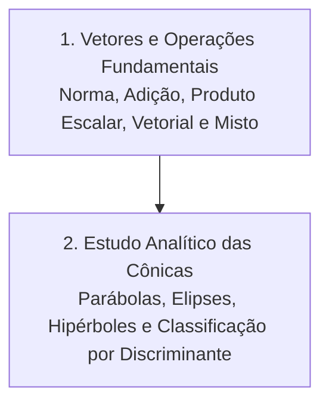

# CM303 - Introdução à Geometria Analítica e Álgebra Linear

**Semestre:** 1º Semestre  
**Carga horária:** 60 h  
**Departamento:** Matemática - UFPR  

---

## 📚 Visão Geral da Disciplina

A disciplina de Geometria Analítica e Álgebra Linear constrói a base formal para representação vetorial, matricial e geométrica dos fenômenos eletromagnéticos, sistemas dinâmicos e circuitos trifásicos. O estudante desenvolve raciocínio geométrico tridimensional aliado à manipulação algébrica formal de matrizes, transformações lineares e autovalores.

---

## 📑 Módulos Teóricos

### [Capítulo 1: Vetores e Operações Fundamentais no Espaço](Capítulo%201%20Vetores%20e%20Operações%20Fundamentais.md)
* Grandezas vetoriais: módulo, direção, sentido e base canônica $(\hat{i}, \hat{j}, \hat{k})$.
* Operações geométricas: regra do paralelogramo, leis dos cossenos e decomposição analítica.
* **Produto Escalar ($\vec{u} \cdot \vec{v}$):** critério de ortogonalidade, cálculo do ângulo entre retas e projeção ortogonal.
* **Produto Vetorial ($\vec{u} \times \vec{v}$):** regra da mão direita, determinante formal e cálculo de área de paralelogramo/triângulo.
* **Produto Misto ($[\vec{u}, \vec{v}, \vec{w}]$):** volume de paralelepípedo e critério de coplanaridade de vetores.

### [Capítulo 2: Estudo Analítico das Seções Cônicas](Capítulo%202%20Estudo%20Analítico%20das%20Cônicas.md)
* Equação geral do 2º grau e classificação analítica pelo discriminante $\Delta = B^2 - 4AC$.
* **Parábola:** foco, diretriz, vértice e equações reduzidas com eixos de simetria horizontal e vertical.
* **Elipse:** focos, relação fundamental ($a^2 = b^2 + c^2$), excentricidade ($e = c/a$) e equações reduzidas.
* **Hipérbole:** focos, assíntotas, relação fundamental ($c^2 = a^2 + b^2$) e ramos conjugados.
