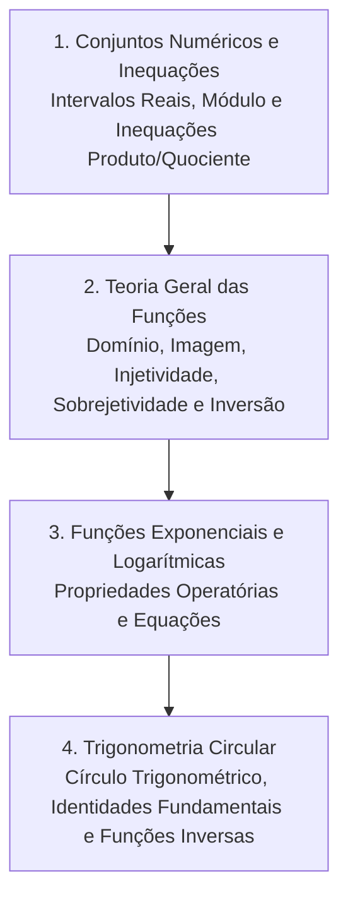

# CM310 - Pré-Cálculo

**Semestre:** 1º Semestre  
**Carga horária:** 60 h  
**Departamento:** Matemática - UFPR  

---

## 📚 Visão Geral da Disciplina

Pré-Cálculo consolida o embasamento em álgebra elementar, trigonometria circular, desigualdades e funções reais fundamentais (polinomiais, exponenciais, logarítmicas e trigonométricas), preparando o estudante para os conceitos infinitesimais de limites, derivadas e integrais.

---

## 📑 Principais Tópicos Teóricos

### 1. Inequações Modulares e Valor Absoluto
* Definição de módulo: $|x| = x$ se $x \ge 0$, e $|x| = -x$ se $x < 0$.
* Propriedades fundamentais:
  $$
  |x| < a \iff -a < x < a \quad (a > 0)
  $$
  $$
  |x| > a \iff x < -a \quad \text{ou} \quad x > a
  $$

### 2. Funções Exponenciais e Logarítmicas
* **Função Exponencial:** $f(x) = a^x$ ($a > 0, a \neq 1$), monótona crescente para $a > 1$.
* **Função Logarítmica:** $g(x) = \log_a(x)$, inversa da exponencial com domínio estrito $x > 0$.
* Propriedades essenciais:
  $$
  \ln(a \cdot b) = \ln(a) + \ln(b), \quad \ln\left(\frac{a}{b}\right) = \ln(a) - \ln(b), \quad \ln(a^k) = k \cdot \ln(a)
  $$

### 3. Trigonometria e Identidades
* Relação Fundamental: $\operatorname{sen}^2(x) + \cos^2(x) = 1$.
* Fórmulas de Arco Duplo:
  $$
  \operatorname{sen}(2x) = 2 \operatorname{sen}(x) \cos(x)
  $$
  $$
  \cos(2x) = \cos^2(x) - \operatorname{sen}^2(x) = 2\cos^2(x) - 1 = 1 - 2\operatorname{sen}^2(x)
  $$
