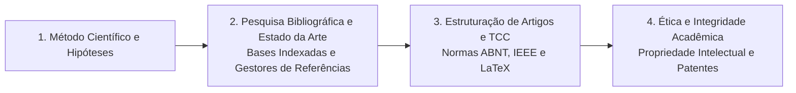

# TE305 - Metodologia de Pesquisa para Engenheiros Eletricistas

**Semestre:** 1º Semestre  
**Carga horária:** 30 h  
**Departamento:** Engenharia Elétrica - UFPR  

---

## 📚 Visão Geral da Disciplina

Capacita o estudante nos métodos de investigação científica, redação técnica padronizada (ABNT/IEEE), busca sistemática em bases de dados bibliográficas (IEEE Xplore, Scopus, Web of Science, Periódicos CAPES), formulação de hipóteses, projeto experimental e ética na pesquisa científica e tecnológica.

---

## 📑 Principais Tópicos Teóricos
* **Estrutura de Trabalhos Acadêmicos:** Elementos pré-textuais, introdução com justificativa e objetivos, fundamentação teórica, metodologia, análise de resultados e conclusões.
* **Normatização Técnica:** Citações diretas e indiretas (NBR 10520), referências bibliográficas (NBR 6023) e estilo IEEE de conferências e periódicos.
* **Propriedade Intelectual:** Patentes de invenção, modelos de utilidade, registro de software e transferência de tecnologia.
