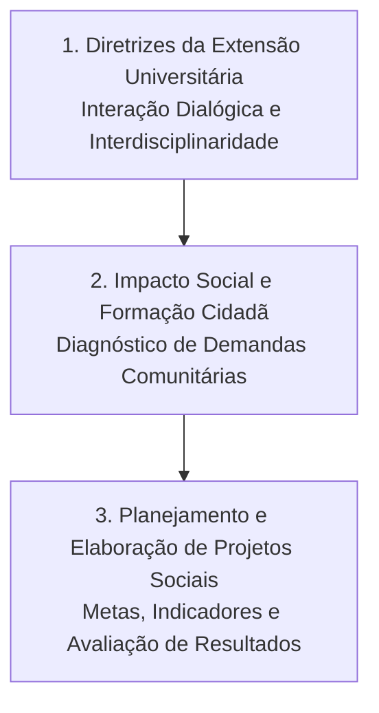

# TE365 - Introdução à Extensão em Engenharia Elétrica

**Semestre:** 1º Semestre  
**Carga horária:** 30 h  
**Departamento:** Engenharia Elétrica - UFPR  

---

## 📚 Visão Geral da Disciplina

Apresenta as diretrizes nacionais de extensão universitária (Resolução CNE/CES nº 7/2018), integrando o conhecimento técnico da engenharia elétrica às demandas reais da sociedade através de projetos comunitários, transferência de tecnologia social, eficiência energética e educação em ciências.

