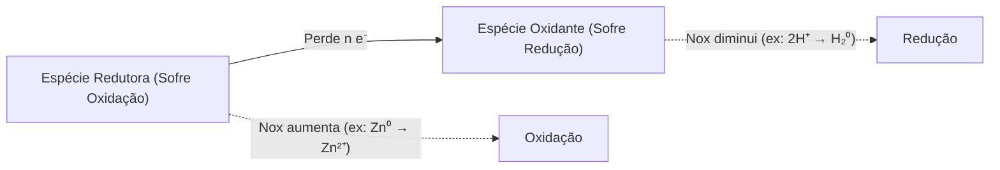
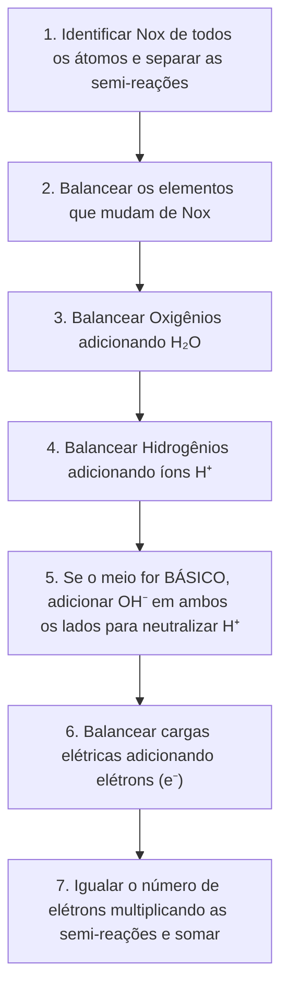

# Capítulo 1: Reações de Oxirredução e Determinação de Elétrons Transferidos

As reações eletroquímicas fundamentam-se na transferência direta ou indireta de elétrons entre espécies químicas. A compreensão rigorosa do Número de Oxidação (Nox) e do balanceamento redox é indispensável para a análise de células galvânicas, baterias, corrosão e proteção catódica em engenharia elétrica.

---

## 1. Conceitos Básicos: Oxidação, Redução e Nox

* **Oxidação:** Processo em que uma espécie química **perde elétrons**, resultando em um **aumento** algébrico do seu número de oxidação ($\Delta \text{Nox} > 0$). A espécie oxidada atua como **agente redutor**.
* **Redução:** Processo em que uma espécie química **ganha elétrons**, acarretando uma **diminuição** algébrica do seu número de oxidação ($\Delta \text{Nox} < 0$). A espécie reduzida atua como **agente oxidante**.

---

## 2. Regras Práticas para Determinação do Nox

1. **Substâncias Simples:** O Nox de átomos em substâncias simples no estado elementar é sempre zero ($\text{Fe}^0$, $\text{Zn}^0$, $\text{H}_2^0$, $\text{O}_2^0$).
2. **Íons Monoatômicos:** O Nox é numericamente igual à própria carga do íon ($\text{Na}^+ = +1$, $\text{Cl}^- = -1$, $\text{Fe}^{3+} = +3$).
3. **Hidrogênio:**
   * Geralmente $+1$ (ligado a não-metais: $\text{H}_2\text{O}$, $\text{HCl}$).
   * $-1$ em hidretos metálicos ($\text{NaH}$, $\text{CaH}_2$).
4. **Oxigênio:**
   * Geralmente $-2$ na maioria dos óxidos e oxoácidos ($\text{H}_2\text{O}$, $\text{SO}_4^{2-}$).
   * $-1$ em peróxidos ($\text{H}_2\text{O}_2$, $\text{Na}_2\text{O}_2$).
5. **Compostos Neutros e Poliatômicos:**
   * Em uma molécula eletricamente neutra: $\sum \text{Nox} = 0$.
   * Em um íon poliatômico: $\sum \text{Nox} = \text{Carga Líquida do Íon}$.
   * Exemplo ($\text{SO}_4^{2-}$): $\text{Nox}_S + 4(-2) = -2 \implies \text{Nox}_S = +6$.

---

## 3. Passo a Passo do Método Íon-Elétron

Para balancear reações redox complexas e encontrar com certeza o **número de elétrons transferidos** ($n$):

---

## 4. Estudo de Caso Prático: Reação do Zinco com Água

Considere a reação redox:

$$
\text{Zn} + 2\text{H}_2\text{O} \longrightarrow \text{Zn(OH)}_2 + \text{H}_2
$$

### Análise dos Estados de Oxidação:
* **Zinco reagente ($\text{Zn}^0$):** Estado elementar, $\text{Nox} = 0$.
* **Zinco no produto ($\text{Zn(OH)}_2$):** $\text{Zn}^{2+}$, $\text{Nox} = +2$. Houve perda de $2 e^-$ (**oxidação**).
* **Hidrogênio na água ($\text{H}_2\text{O}$):** $\text{Nox} = +1$.
* **Hidrogênio no gás ($\text{H}_2^0$):** $\text{Nox} = 0$. Houve ganho de $1 e^-$ por átomo de hidrogênio (**redução**).

### Semi-reações:
1. **Semi-reação de Oxidação:**
   $$
   \text{Zn}_{(s)} \longrightarrow \text{Zn}^{2+} + 2e^-
   $$
2. **Semi-reação de Redução:**
   $$
   2\text{H}^+ + 2e^- \longrightarrow \text{H}_{2(g)}
   $$

### Conclusão:
O número total de elétrons transferidos na reação estequiométrica balanceada é:

$$
n = 2\text{ mol de } e^- \text{ por mol de Zn consumido}
$$

Este valor de $n$ é o parâmetro fundamental inserido nas leis de Faraday da eletrólise ($m = \frac{Q M}{n F}$) e na Equação de Nernst ($E = E^0 - \frac{RT}{nF} \ln Q$).
