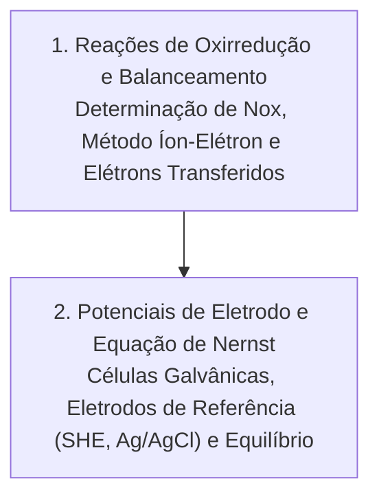

# TQ190 - Introdução à Eletroquímica

**Semestre:** 1º Semestre  
**Carga horária:** 30 h  
**Departamento:** Engenharia Química / Engenharia Elétrica - UFPR  

---

## 📚 Visão Geral da Disciplina

A disciplina de Eletroquímica fornece as bases termodinâmicas e cinéticas das transformações químicas que envolvem transferência de elétrons. O domínio desses conceitos é essencial para o engenheiro eletricista na especificação de sistemas de armazenamento de energia (baterias de chumbo-ácido, íon-lítio e fluxo), células a combustível, corrosão galvânica e proteção catódica de estruturas elétricas e de aterramento.

---

## 📑 Capítulos e Conteúdos Teóricos

### [Capítulo 1: Reações de Oxirredução e Determinação de Elétrons Transferidos](Capítulo%201%20Reações%20de%20Oxirredução%20e%20Balanceamento.md)
* Definições fundamentais de oxidação, redução, agente redutor e agente oxidante.
* Regras práticas para cálculo do Número de Oxidação (Nox) em compostos neutros e íons poliatômicos.
* Método sistemático do íon-elétron para balanceamento redox em meio ácido e meio básico.
* Estudo de caso: determinação quantitativa dos elétrons transferidos na reação do zinco com água.

### [Capítulo 2: Potenciais de Eletrodo, Células Galvânicas e Equação de Nernst](Capítulo%202%20Potenciais%20de%20Eletrodo%20e%20Equação%20de%20Nernst.md)
* Células galvânicas vs. células eletrolíticas: distinção entre ânodo (oxidação) e cátodo (redução).
* Eletrodos de referência: Eletrodo Padrão de Hidrogênio (SHE), eletrodo $\text{Ag/AgCl}$ e eletrodo $\text{Cu/CuSO}_4$.
* Força eletromotriz padrão ($E^0_{\text{cél}}$) e espontaneidade termodinâmica ($\Delta G^0 = -nFE^0$).
* A Equação de Nernst: dependência da d.d.p. em relação à concentração dos reagentes/produtos e condição de bateria esgotada ($E = 0$).
