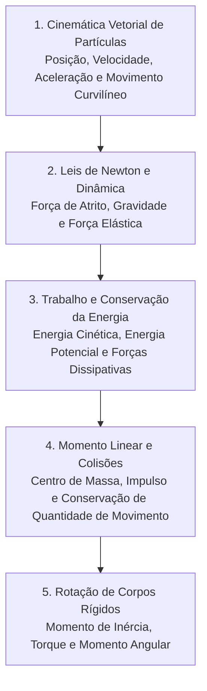

# CF109 - Física I

**Semestre:** 2º Semestre  
**Carga horária:** 60 h  
**Departamento:** Física - UFPR  

---

## 📚 Visão Geral da Disciplina

Física I estuda a mecânica clássica newtoniana: cinemática escalar e vetorial de partículas, dinâmica sob forças fundamentais, princípios de conservação de energia mecânica e quantidade de movimento linear, cinemática e dinâmica rotacional de corpos rígidos.

---

## 📑 Principais Tópicos Teóricos

### 1. As Três Leis de Newton
1. **Lei da Inércia:** Todo corpo permanece em seu estado de repouso ou de movimento retilíneo uniforme a menos que seja obrigado a mudar seu estado por forças aplicadas sobre ele ($\sum \vec{F} = \vec{0} \implies \vec{v} = \text{cte}$).
2. **Princípio Fundamental da Dinâmica:** A aceleração de um corpo é diretamente proporcional à força resultante que atua sobre ele:
   $$
   \sum \vec{F} = m \vec{a} = \frac{d\vec{p}}{dt}
   $$
3. **Ação e Reação:** Para toda ação há sempre uma reação oposta e de igual intensidade ($\vec{F}_{AB} = -\vec{F}_{BA}$).

### 2. Teorema do Trabalho e Energia Cinética
O trabalho realizado pela resultante de todas as forças atuantes em uma partícula ao longo de uma trajetória é igual à variação de sua energia cinética:

$$
W_{\text{total}} = \int_{\vec{r}_1}^{\vec{r}_2} \vec{F} \cdot d\vec{r} = \Delta K = \frac{1}{2}m v_2^2 - \frac{1}{2}m v_1^2
$$

Para sistemas sob ação exclusiva de **forças conservativas** (gravidade, mola ideal):

$$
E_{\text{mec}} = K + U = \text{constante}
$$

### 3. Rotação de Corpos Rígidos
* **Torque ($\vec{\tau}$):** $\vec{\tau} = \vec{r} \times \vec{F} \implies \tau = r F \operatorname{sen}\theta$.
* **Momento de Inércia ($I$):** Medida da inércia rotacional $I = \sum m_i r_i^2 = \int r^2 dm$.
* **Segunda Lei para Rotações:**
  $$
  \sum \vec{\tau} = I \vec{\alpha} = \frac{d\vec{L}}{dt}
  $$
