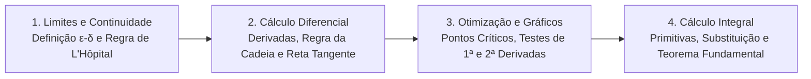

# CM311 - Cálculo 1

**Semestre:** 2º Semestre  
**Carga horária:** 60 h  
**Departamento:** Matemática - UFPR  

---

## 📚 Visão Geral da Disciplina

Cálculo Diferencial e Integral de uma variável real é o pilar analítico de toda a engenharia. Desenvolve o estudo rigoroso de limites, continuidade, taxas de variação instantânea (derivadas), otimização de funções e cálculo de áreas acumuladas via Teorema Fundamental do Cálculo.

---

## 📑 Principais Tópicos Teóricos

### 1. Limites e Regra de L'Hôpital
* **Definição Formal ($\epsilon$-$\delta$):** $\lim_{x \to a} f(x) = L$ significa que para todo $\epsilon > 0$, existe $\delta > 0$ tal que se $0 < |x - a| < \delta$, então $|f(x) - L| < \epsilon$.
* **Formas Indeterminadas ($\frac{0}{0}$ ou $\frac{\infty}{\infty}$):**
  $$
  \lim_{x \to a} \frac{f(x)}{g(x)} = \lim_{x \to a} \frac{f'(x)}{g'(x)}
  $$

### 2. Regras de Derivação e Regra da Cadeia
* **Produto:** $(u \cdot v)' = u' v + u v'$
* **Quociente:** $\left(\frac{u}{v}\right)' = \frac{u' v - u v'}{v^2}$
* **Regra da Cadeia:** $\frac{d}{dx} [f(g(x))] = f'(g(x)) \cdot g'(x)$

### 3. Análise de Funções e Otimização
* **Pontos Críticos:** Pontos do domínio onde $f'(x) = 0$ ou $f'(x)$ não existe.
* **Teste da Segunda Derivada:**
  * $f''(x_0) > 0 \implies$ Ponto de **Mínimo Local** (concavidade para cima).
  * $f''(x_0) < 0 \implies$ Ponto de **Máximo Local** (concavidade para baixo).
  * $f''(x_0) = 0 \implies$ Inconclusivo (possível ponto de inflexão).

### 4. Integração e Teorema Fundamental do Cálculo
Seja $f$ contínua em $[a, b]$ e $F$ uma primitiva ($F' = f$):

$$
\int_a^b f(x) \, dx = F(b) - F(a)
$$
