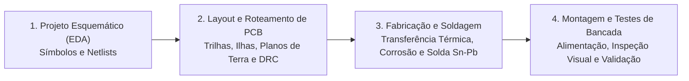

# TE311 - Oficina de Projetos em Engenharia Elétrica

**Semestre:** 2º Semestre  
**Carga horária:** 30 h  
**Departamento:** Engenharia Elétrica - UFPR  

---

## 📚 Visão Geral da Disciplina

Disciplina prática que desenvolve habilidades de projeto e fabricação de sistemas elétricos e eletrônicos: desenho esquemático e layout de Placas de Circuito Impresso (PCB) em software EDA (KiCad/EasyEDA), processos de corrosão e furação, técnicas manuais de soldagem SMD e THT, montagem de protótipos e instrumentação básica de validação.

