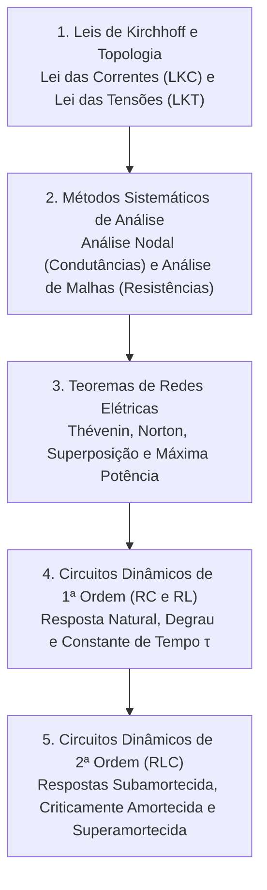

# TE313 - Circuitos Elétricos I

**Semestre:** 2º Semestre  
**Carga horária:** 60 h  
**Departamento:** Engenharia Elétrica - UFPR  

---

## 📚 Visão Geral da Disciplina

Circuitos Elétricos I estabelece as bases fundamentais da análise linear em corrente contínua (CC) e regime transitório. O curso aborda as leis topológicas de Kirchhoff, métodos sistemáticos de nós e malhas, teoremas de redes (Thévenin, Norton, Superposição, Máxima Transferência de Potência) e a resposta no tempo de circuitos dinâmicos de 1ª e 2ª ordem ($RC$, $RL$ e $RLC$).

---

## 📑 Principais Tópicos Teóricos

### 1. Teoremas de Thévenin e Norton
Qualquer rede linear resistiva com fontes independentes e dependentes, vista de dois terminais $A$ e $B$, pode ser substituída por:
* **Circuito Equivalente de Thévenin:** Uma fonte de tensão $V_{th}$ (tensão de circuito aberto $V_{AB,\text{ca}}$) em série com uma resistência equivalente $R_{th}$.
* **Circuito Equivalente de Norton:** Uma fonte de corrente $I_N$ (corrente de curto-circuito $I_{AB,\text{cc}}$) em paralelo com $R_N = R_{th}$.
* **Relação de Fonte:**
  $$
  V_{th} = R_{th} \cdot I_N \implies R_{th} = \frac{V_{\text{ca}}}{I_{\text{cc}}}
  $$

### 2. Teorema da Máxima Transferência de Potência
Uma carga puramente resistiva $R_L$ conectada a uma rede real extrai a máxima potência quando sua resistência for exatamente igual à resistência de Thévenin do circuito:

$$
R_L = R_{th} \implies P_{\max} = \frac{V_{th}^2}{4 R_{th}}
$$

### 3. Circuitos de 1ª Ordem ($RC$ e $RL$)
Equação diferencial geral com excitação constante:

$$
x(t) = x(\infty) + [x(0) - x(\infty)] e^{-\frac{t}{\tau}}
$$

* Para circuito $RC$: $\tau = R_{th} C$.
* Para circuito $RL$: $\tau = \frac{L}{R_{th}}$.
