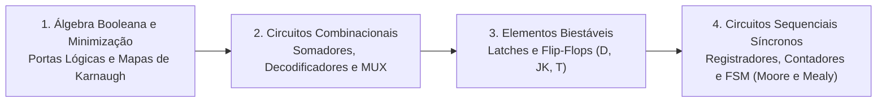

# TE314 - Eletrônica Digital

**Semestre:** 2º Semestre  
**Carga horária:** 60 h  
**Departamento:** Engenharia Elétrica - UFPR  

---

## 📚 Visão Geral da Disciplina

Eletrônica Digital aborda os sistemas de numeração binária, portas lógicas fundamentais, álgebra de Boole, minimização de funções booleanas (mapas de Karnaugh), projeto de circuitos combinacionais (multiplexadores, somadores, decodificadores) e circuitos sequenciais síncronos baseados em Flip-Flops e Máquinas de Estados Finitos (FSM).

---

## 📑 Principais Tópicos Teóricos

### 1. Postulados e Teoremas de De Morgan
As simplificações booleanas obedecem aos teoremas fundamentais de inversão dupla:

$$
\overline{A + B} = \overline{A} \cdot \overline{B}
$$
$$
\overline{A \cdot B} = \overline{A} + \overline{B}
$$

### 2. Minimização por Mapas de Karnaugh (K-Map)
Agrupamento geométrico de $2^n$ células adjacentes com termos $1$ em formato de código Gray, permitindo eliminar variáveis complementadas e obter a expressão mínima em **Soma de Produtos (SOP)** ou **Produto de Somas (POS)**.

### 3. Elementos Sequenciais: Latches e Flip-Flops
* **Flip-Flop Tipo D (Data):** Transfere o dado $D$ para a saída $Q$ na borda ativa de clock ($Q_{\text{next}} = D$).
* **Flip-Flop Tipo JK:** Elimina a condição indeterminada do latch SR através da comutação (*toggle*):
  $$
  Q_{\text{next}} = J\overline{Q} + \overline{K}Q
  $$
* **Flip-Flop Tipo T (Toggle):** Inverte o estado de saída quando $T = 1$ na borda de clock ($Q_{\text{next}} = T \oplus Q$).
