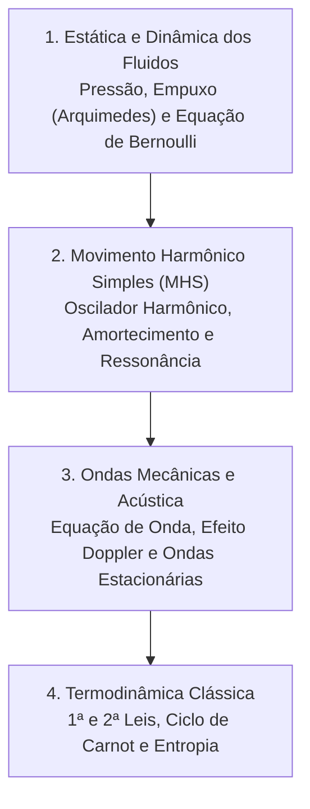

# CF110 - Física II

**Semestre:** 3º Semestre  
**Carga horária:** 60 h  
**Departamento:** Física - UFPR  

---

## 📚 Visão Geral da Disciplina

Física II cobre estática e dinâmica de fluidos, oscilações mecânicas (harmônicas, amortecidas e forçadas com ressonância), propagação de ondas mecânicas e sonoras, e as leis fundamentais da termodinâmica aplicadas a máquinas térmicas.

---

## 📑 Principais Tópicos Teóricos

### 1. Movimento Harmônico Simples (MHS)
Equação diferencial linear de segunda ordem:

$$
\frac{d^2 x}{dt^2} + \omega_0^2 x = 0 \implies x(t) = A \cos(\omega_0 t + \phi)
$$

onde $\omega_0 = \sqrt{\frac{k}{m}}$ (sistema massa-mola) ou $\omega_0 = \sqrt{\frac{g}{L}}$ (pêndulo simples).

### 2. Ondas Mecânicas e Efeito Doppler
* Equação da onda unidimensional:
  $$
  \frac{\partial^2 y}{\partial x^2} = \frac{1}{v^2} \frac{\partial^2 y}{\partial t^2}
  $$
* Frequência aparente pelo Efeito Doppler acústico:
  $$
  f' = f \left( \frac{v \pm v_o}{v \mp v_f} \right)
  $$

### 3. Termodinâmica: Leis Fundamentais e Ciclo de Carnot
* **1ª Lei da Termodinâmica:** $\Delta U = Q - W$.
* **Rendimento Térmico de Máquinas:** $\eta = 1 - \frac{|Q_F|}{Q_Q}$.
* **Rendimento Máximo de Carnot:**
  $$
  \eta_{\text{Carnot}} = 1 - \frac{T_F}{T_Q}
  $$
