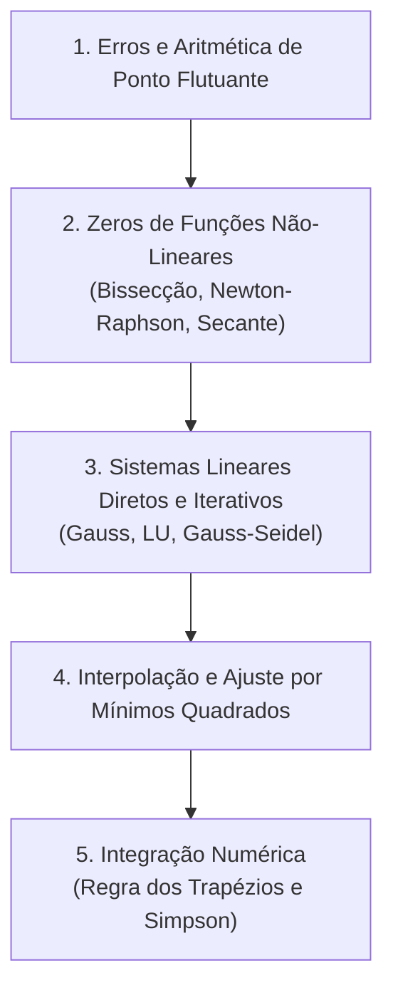

# CI181 - Métodos Numéricos

**Semestre:** 3º Semestre  
**Carga horária:** 60 h  
**Departamento:** Informática - UFPR  
**Página Oficial:** [inf.ufpr.br/cursos/ci181](https://www.inf.ufpr.br/cursos/ci181/)

---

## 📚 Visão Geral da Disciplina

Os **Métodos Numéricos** fornecem algoritmos matemáticos determinísticos para obter aproximações numéricas confiáveis para problemas onde soluções analíticas exatas são inviáveis ou computacionalmente custosas. Na engenharia elétrica, são essenciais para simulações de fluxo de potência em SEP, transitórios eletromagnéticos e modelagem de dispositivos semicondutores.

---

## 📑 Principais Tópicos Teóricos

### 1. Representação de Números e Teoria dos Erros
* **Ponto Flutuante (IEEE 754):** mantissa, expoente e base.
* **Erros Absoluto e Relativo:**
  $$
  E_{\text{abs}} = |x - \bar{x}|, \quad E_{\text{rel}} = \frac{|x - \bar{x}|}{|x|}
  $$
* **Erro de Arredondamento vs. Erro de Truncamento:** perda de dígitos significativos por cancelamento subtrativo e propagação de erros em cadeias computacionais.

---

### 2. Zeros de Equações Não-Lineares ($f(x) = 0$)
* **Método da Bissecção:** Baseado no Teorema do Valor Intermediário (Bolzano). Convergência linear garantida para funções contínuas se $f(a) \cdot f(b) < 0$.
* **Método de Newton-Raphson:** Aproximação por reta tangente local, convergência quadrática rápida nas vizinhanças da raiz:
  $$
  x_{k+1} = x_k - \frac{f(x_k)}{f'(x_k)}
  $$
* **Método da Secante:** Variante de Newton que substitui a derivada analítica $f'(x)$ pela aproximação numérica da inclinação entre dois pontos sucessivos.

---

### 3. Sistemas de Equações Lineares ($A x = b$)
* **Métodos Diretos:**
  * **Eliminação de Gauss:** Transformação da matriz ampliada em uma matriz triangular superior com escalonamento e pivoteamento parcial (para evitar divisão por números próximos de zero).
  * **Fatoração $LU$:** Decomposição de $A$ em produto de matriz triangular inferior $L$ e superior $U$ ($A = LU$), agilizando múltiplas soluções para diferentes vetores de excitação $b$.
* **Métodos Iterativos:**
  * **Gauss-Jacobi:** Calcula $x_i^{(k+1)}$ usando apenas os valores da iteração anterior $k$.
  * **Gauss-Seidel:** Atualiza imediatamente as variáveis recém-calculadas na mesma iteração, acelerando a taxa de convergência (requer matriz estritamente diagonal dominante para convergência incondicional).

---

### 4. Interpolação e Ajuste de Curvas
* **Interpolação Polinomial de Lagrange:** Polinômio único de grau $n$ que passa exatamente por $n+1$ pontos discretos:
  $$
  P_n(x) = \sum_{i=0}^n y_i L_i(x), \quad L_i(x) = \prod_{j \neq i} \frac{x - x_j}{x_i - x_j}
  $$
* **Método de Newton com Diferenças Divididas:** Construção incremental do polinômio sem recalcular toda a base.
* **Ajuste de Curvas por Mínimos Quadrados (Regressão):** Quando os dados possuem ruído experimental, minimiza-se a soma dos quadrados dos resíduos $\sum (y_i - f(x_i))^2$, recaindo nas equações normais de Gauss.

---

### 5. Integração Numérica
* **Regra dos Trapézios Composta:** Aproxima a área sob $f(x)$ por uma soma de trapézios em $N$ subintervalos de largura $h = \frac{b-a}{N}$:
  $$
  \int_a^b f(x) \, dx \approx \frac{h}{2} \left[ f(x_0) + 2 \sum_{i=1}^{N-1} f(x_i) + f(x_N) \right]
  $$
* **Regra 1/3 de Simpson Composta:** Ajusta parábolas em pares de subintervalos adjacentes:
  $$
  \int_a^b f(x) \, dx \approx \frac{h}{3} \left[ f(x_0) + 4 \sum_{i \text{ ímpar}} f(x_i) + 2 \sum_{i \text{ par}} f(x_i) + f(x_N) \right]
  $$
