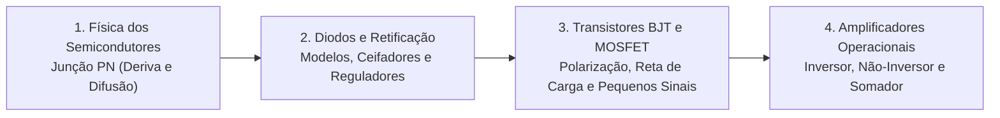

# TE324 - Eletrônica Analógica I

**Semestre:** 3º Semestre  
**Carga horária:** 60 h  
**Departamento:** Engenharia Elétrica - UFPR  

---

## 📚 Visão Geral da Disciplina

Eletrônica Analógica I estuda a física dos materiais semicondutores intrínsecos e dopados, o funcionamento da junção PN, a modelagem de circuitos com diodos, a operação de transistores bipolares de junção (BJT) e de efeito de campo (MOSFET) em pequenos e grandes sinais, finalizando com o amplificador operacional ideal e suas principais topologias de condicionamento de sinais.

---

## 📑 Principais Tópicos Teóricos

### 1. Física dos Semicondutores e a Junção PN
* **Semicondutores Tipo P e Tipo N:** Dopagem por elementos trivalentes (lacunas) e pentavalentes (elétrons livres).
* **Corrente de Difusão ($I_{\text{dif}}$):** Movimento de portadores de carga majoritários impulsionado pelo gradiente de concentração através da junção (elétrons de N para P, lacunas de P para N).
* **Região de Depleção (Camada de Carga Espacial):** Formação de íons fixos não neutralizados na fronteira, criando uma barreira de potencial intrínseca ($V_0 \approx 0{,}7\text{ V}$ no Silício a $300\text{ K}$).
* **Corrente de Deriva ($I_{\text{deriva}}$):** Portadores minoritários acelerados pelo campo elétrico interno da barreira. Em equilíbrio térmico sem polarização externa:
  $$
  I_{\text{total}} = I_{\text{dif}} - I_{\text{deriva}} = 0
  $$
* **Polarização Inversa e Corrente de Saturação ($I_S$):** Ao aplicar $V < 0$, a barreira alarga-se e a corrente líquida reduz-se à pequena corrente de fuga térmica $I_S$ gerada pelos minoritários na região de depleção.

---

### 2. A Equação do Diodo Real (Shockley)

$$
i_D = I_S \left( e^{\frac{v_D}{n V_T}} - 1 \right)
$$

onde:
* $V_T = \frac{k T}{q} \approx 25\text{ mV}$ ou $26\text{ mV}$ à temperatura ambiente ($25^\circ\text{C}$).
* $n$ é o fator de idealidade ($1 \le n \le 2$).

---

### 3. Modelos de Transistores (BJT e MOSFET)
* **BJT (Transistor Bipolar de Junção):**
  * Dispositivo controlado por corrente: $I_C = \beta I_B$.
  * Regiões de operação: Corte ($I_B = 0$, chave aberta), Ativa (amplificação linear) e Saturação ($V_{CE} \approx 0{,}2\text{ V}$, chave fechada).
* **MOSFET (Transistor de Efeito de Campo MOS):**
  * Dispositivo controlado por tensão na porta ($V_{GS}$), sem corrente estática no gate ($I_G \approx 0$).
  * Em saturação (região de fonte de corrente constante):
    $$
    I_D = \frac{1}{2} k_n' \left(\frac{W}{L}\right) (V_{GS} - V_t)^2
    $$

---

### 4. Amplificadores Operacionais Ideais (Amp-Op)
Premissas do Amp-Op ideal:
* Ganho de malha aberta infinito ($A_{OL} \to \infty$).
* Impedância de entrada infinita ($R_{in} \to \infty \implies i_+ = i_- = 0$).
* Impedância de saída nula ($R_{out} = 0$).
* **Curto-Circuito Virtual:** Com realimentação negativa, $v_+ \approx v_-$.

#### Topologias Clássicas:
* **Amplificador Inversor:**
  $$
  v_o = - \left(\frac{R_f}{R_1}\right) v_i
  $$
* **Amplificador Não-Inversor:**
  $$
  v_o = \left(1 + \frac{R_f}{R_1}\right) v_i
  $$
* **Buffer / Seguidor de Tensão ($R_f = 0$):**
  $$
  v_o = v_i \quad (\text{Isolação de impedância de alto ganho de corrente})
  $$
