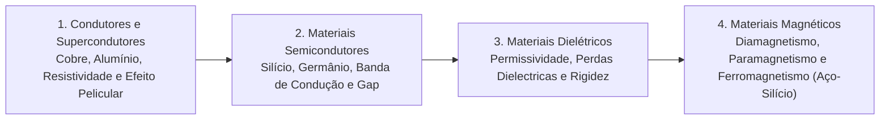

# TE337 - Materiais Elétricos

**Semestre:** 3º Semestre  
**Carga horária:** 60 h  
**Departamento:** Engenharia Elétrica - UFPR  

---

## 📚 Visão Geral da Disciplina

Estuda a estrutura atômica e o comportamento microscópico dos materiais utilizados na engenharia elétrica, correlacionando propriedades cristalográficas com o desempenho de condutores, semicondutores, isolantes/dielétricos e materiais magnéticos.

---

## 📑 Principais Tópicos Teóricos

### 1. Materiais Condutores e Efeito Skin
* **Variação da Resistividade com a Temperatura:**
  $$
  \rho(T) = \rho_0 [1 + \alpha (T - T_0)]
  $$
* **Efeito Pelicular (Skin Effect):** Em corrente alternada, a densidade de corrente concentra-se na periferia do condutor. A profundidade de penetração ($\delta$) é:
  $$
  \delta = \sqrt{\frac{\rho}{\pi f \mu}}
  $$

### 2. Materiais Dielétricos e Isolantes
* **Rigidez Dielétrica ($E_r$):** Máximo campo elétrico suportado antes da ruptura dielétrica.
* **Fator de Perdas Dielétricas ($\tan\delta$):** Dissipação de calor sob campo alternado devido ao atraso de polarização dipolar.

### 3. Materiais Ferromagnéticos
* Domínios de Weiss e Ciclo de Histerese ($B \times H$).
* **Aço-Silício:** O silício aumenta a resistividade do ferro, reduzindo drasticamente as perdas por correntes de Foucault ($P_{\text{Foucault}} \propto f^2 B_{\max}^2 t_{\text{lâmina}}^2 / \rho$).
