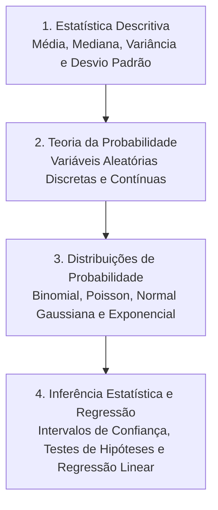

# CE009 - Introdução à Estatística

**Semestre:** 4º Semestre  
**Carga horária:** 60 h  
**Departamento:** Estatística - UFPR  

---

## 📚 Visão Geral da Disciplina

Fornece o instrumental probabilístico e estatístico para tratamento de dados experimentais, controle de qualidade, confiabilidade de sistemas e previsão de demanda em engenharia elétrica.

---

## 📑 Principais Tópicos Teóricos
* **Distribuição Normal (Gaussiana):**
  $$
  f(x) = rac{1}{\sigma \sqrt{2\pi}} e^{-rac{(x - \mu)^2}{2\sigma^2}}
  $$
* **Teorema Central do Limite:** A soma (ou média) de um grande número de variáveis aleatórias independentes tende assintoticamente a uma distribuição normal, independentemente da distribuição original das variáveis.
