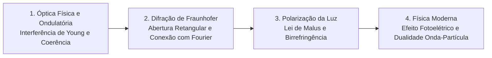

# CF112 - Física IV

**Semestre:** 4º Semestre  
**Carga horária:** 60 h  
**Departamento:** Física - UFPR  

---

## 📚 Visão Geral da Disciplina

Física IV compreende o estudo dos fenômenos ondulatórios avançados, óptica geométrica e física (interferência, difração, polarização), relatividade restrita e introdução à física quântica. Na Engenharia Elétrica, fornece os fundamentos físicos para telecomunicações por fibra óptica, antenas, compatibilidade eletromagnética e sistemas de radiofrequência.

---

## 📑 A Conexão Matemática entre Difração de Fraunhofer e Transformada de Fourier

A difração de campo distante (Fraunhofer) em uma abertura plana é a realização física direta de uma **Transformada de Fourier espacial**.

### 1. Geometria e Diferença de Caminho Óptico
Considere uma fenda unidimensional ao longo do eixo $x$. Para um ponto de observação no anteparo distante fazendo ângulo $\theta$ com o eixo normal da fenda, a diferença de caminho óptico entre uma onda que parte do ponto $x$ e uma que parte do centro da fenda é:

$$
\Delta r(x) \approx x \operatorname{sen}\theta
$$

Pelo princípio de Huygens-Fresnel, a contribuição de fase diferencial é:

$$
e^{-j k \Delta r(x)} = e^{-j k x \operatorname{sen}\theta}
$$

onde $k = \frac{2\pi}{\lambda}$ é o número de onda espacial ($\text{rad/m}$).

---

### 2. Identificação com o Kernel da Transformada de Fourier
Substituindo $k$:

$$
e^{-j k x \operatorname{sen}\theta} = e^{-j \frac{2\pi}{\lambda} x \operatorname{sen}\theta} = e^{-j 2\pi \left(\frac{\operatorname{sen}\theta}{\lambda}\right) x}
$$

Comparando com o kernel padrão da Transformada de Fourier contínua:

$$
\mathcal{F}\{x(t)\} = \int_{-\infty}^\infty x(t) e^{-j 2\pi f t} \, dt
$$

Identificam-se diretamente as variáveis correspondentes:
* A variável temporal $t$ corresponde à **posição espacial na fenda $x$** (em metros).
* A frequência temporal $f$ corresponde à **frequência espacial $f_x$** (em ciclos por metro):
  $$
  f_x \equiv \frac{\operatorname{sen}\theta}{\lambda}
  $$

Logo, o campo elétrico difratado no infinito $E(\theta)$ é a Transformada de Fourier espacial da função de abertura $A(x)$:

$$
E(\theta) \propto \int_{-\infty}^\infty A(x) e^{-j 2\pi f_x x} \, dx = \widehat{A}(f_x) \quad \text{com } f_x = \frac{\operatorname{sen}\theta}{\lambda}
$$

---

### 3. Exemplo Analítico: Fenda Retangular Simples
Para uma fenda de largura $D$ descrita pela função pulso retangular $A(x) = \Pi(x/D)$ ($1$ para $|x| \le D/2$ e $0$ fora):

$$
E(\theta) \propto \int_{-D/2}^{D/2} e^{-j 2\pi f_x x} \, dx = \left[ \frac{e^{-j 2\pi f_x x}}{-j 2\pi f_x} \right]_{-D/2}^{D/2} = \frac{\operatorname{sen}(\pi f_x D)}{\pi f_x} = D \operatorname{sinc}(\pi f_x D)
$$

Substituindo a frequência espacial $f_x = \frac{\operatorname{sen}\theta}{\lambda}$:

$$
E(\theta) \propto D \operatorname{sinc}\left( \frac{\pi D \operatorname{sen}\theta}{\lambda} \right)
$$

A intensidade luminosa projetada no anteparo ($I \propto |E|^2$) exibe o padrão clássico de difração:

$$
I(\theta) = I_0 \left[ \frac{\operatorname{sen}\left(\frac{\pi D \operatorname{sen}\theta}{\lambda}\right)}{\frac{\pi D \operatorname{sen}\theta}{\lambda}} \right]^2
$$
