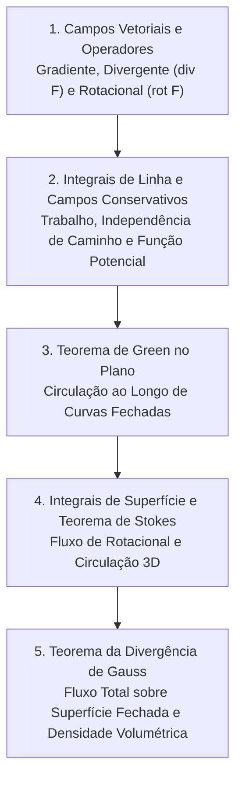

# CM313 - Cálculo 3

**Semestre:** 4º Semestre  
**Carga horária:** 60 h  
**Departamento:** Matemática - UFPR  

---

## 📚 Visão Geral da Disciplina

Cálculo Vetorial e Teoria de Campos: integração sobre curvas e superfícies e os três teoremas fundamentais do cálculo vetorial (Green, Stokes e Gauss/Divergência), que fundamentam as equações de Maxwell do eletromagnetismo.

---

## 📑 Os Grandes Teoremas Vetoriais

### 1. Teorema de Green no Plano
Relaciona a integral de linha sobre uma curva fechada simples $C$ à integral dupla na região $D$:

$$
\oint_C (P \, dx + Q \, dy) = \iint_D \left( \frac{\partial Q}{\partial x} - \frac{\partial P}{\partial y} \right) dx dy
$$

### 2. Teorema de Stokes (Rotacional)
Relaciona a circulação de um campo vetorial $\vec{F}$ ao longo da fronteira $\partial S$ com o fluxo do rotacional sobre a superfície $S$:

$$
\oint_{\partial S} \vec{F} \cdot d\vec{r} = \iint_S (\nabla \times \vec{F}) \cdot d\vec{S}
$$

### 3. Teorema da Divergência (Gauss)
O fluxo líquido de um campo $\vec{F}$ através de uma superfície fechada $S$ é igual à integral do divergente no volume $V$ delimitado:

$$
\oiint_S \vec{F} \cdot d\vec{S} = \iiint_V (\nabla \cdot \vec{F}) \, dV
$$
