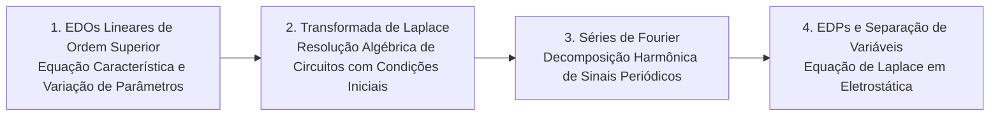

# TE315 - Equações Diferenciais para Engenharia Elétrica

**Semestre:** 4º Semestre  
**Carga horária:** 60 h  
**Departamento:** Engenharia Elétrica - UFPR  

---

## 📚 Visão Geral da Disciplina

Estuda equações diferenciais ordinárias (EDOs) lineares de coeficientes constantes, transformadas integrais (Transformada de Laplace) e equações diferenciais parciais (EDPs) clássicas da física matemática (onda, difusão/calor e Laplace/Poisson) resolvidas por separação de variáveis e Séries de Fourier.

---

## 📑 Principais Tópicos Teóricos

### 1. Transformada de Laplace
Define-se para $t \ge 0$:

$$
\mathcal{L}\{f(t)\} = F(s) = \int_0^\infty f(t) e^{-st} \, dt
$$

* **Propriedade da Derivada:**
  $$
  \mathcal{L}\{f'(t)\} = s F(s) - f(0^-)
  $$
  $$
  \mathcal{L}\{f''(t)\} = s^2 F(s) - s f(0^-) - f'(0^-)
  $$

### 2. Séries Trigonométricas de Fourier
Qualquer sinal periódico com período $T$ ($f(t) = f(t+T)$) pode ser decomposto como:

$$
f(t) = \frac{a_0}{2} + \sum_{n=1}^\infty \left[ a_n \cos(n \omega_0 t) + b_n \operatorname{sen}(n \omega_0 t) \right]
$$
