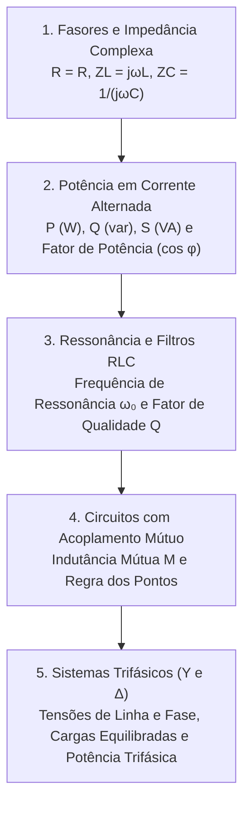

# TE318 - Circuitos Elétricos II

**Semestre:** 4º Semestre  
**Carga horária:** 60 h  
**Departamento:** Engenharia Elétrica - UFPR  

---

## 📚 Visão Geral da Disciplina

Circuitos Elétricos II cobre a análise em regime permanente senoidal (RPS) utilizando fasores e impedâncias complexas, cálculo de potências ativas, reativas e aparentes com correção de fator de potência, ressonância série e paralela, circuitos magneticamente acoplados e sistemas trifásicos equilibrados e desequilibrados ($Y$ e $\Delta$).

---

## 📑 Principais Tópicos Teóricos

### 1. Triângulo de Potências em CA
* **Potência Aparente Complexa:**
  $$
  S = P + jQ = \vec{V}_{\text{rms}} \cdot \vec{I}_{\text{rms}}^* = |S| \angle \theta
  $$
* **Potência Ativa (Watts):** $P = V_{\text{rms}} I_{\text{rms}} \cos\theta$.
* **Potência Reativa (var):** $Q = V_{\text{rms}} I_{\text{rms}} \operatorname{sen}\theta$.
* **Fator de Potência:** $FP = \cos\theta = \frac{P}{|S|}$.

### 2. Sistemas Trifásicos Equilibrados
* **Ligação Estrela ($Y$):** $V_L = \sqrt{3} V_F \angle +30^\circ$, $I_L = I_F$.
* **Ligação Triângulo ($\Delta$):** $V_L = V_F$, $I_L = \sqrt{3} I_F \angle -30^\circ$.
* **Potência Trifásica Total:**
  $$
  S_{3\phi} = \sqrt{3} V_L I_L \quad [\text{VA}]
  $$
  $$
  P_{3\phi} = \sqrt{3} V_L I_L \cos\theta \quad [\text{W}]
  $$
