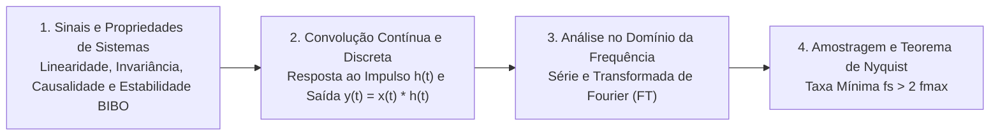

# TE322 - Sinais e Sistemas

**Semestre:** 4º Semestre  
**Carga horária:** 60 h  
**Departamento:** Engenharia Elétrica - UFPR  

---

## 📚 Visão Geral da Disciplina

Estuda a classificação matemática e modelagem de sinais contínuos e discretos no tempo, as propriedades de sistemas Lineares e Invariantes no Tempo (LIT), a operação fundamental de convolução, a Série e Transformada de Fourier contínua e discreta, a Transformada de Laplace e a Transformada Z.

---

## 📑 Principais Tópicos Teóricos

### 1. Convolução em Sistemas LIT
A saída de qualquer sistema linear e invariante no tempo a uma entrada arbitrária $x(t)$ é dada pela integral de convolução com a resposta ao impulso $h(t)$:

$$
y(t) = x(t) * h(t) = \int_{-\infty}^\infty x(\tau) h(t - \tau) \, d\tau
$$

No domínio da frequência, a convolução converte-se no produto direto das transformadas:

$$
Y(\omega) = X(\omega) \cdot H(\omega)
$$

### 2. Teorema da Amostragem de Nyquist-Shannon
Para que um sinal de tempo contínuo de banda limitada possa ser reconstruído exatamente a partir de suas amostras discretas:

$$
f_s \ge 2 f_{\max}
$$
