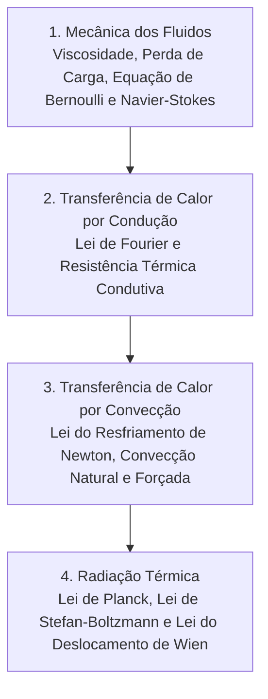

# TH063 - Fenômenos de Transporte na Engenharia

**Semestre:** 4º Semestre  
**Carga horária:** 60 h  
**Departamento:** Engenharia Química / Mecânica - UFPR  

---

## 📚 Visão Geral da Disciplina

A disciplina de Fenômenos de Transporte unifica o estudo da transferência de quantidade de movimento (mecânica dos fluidos), transferência de calor (condução, convecção e radiação) e transferência de massa. Para a Engenharia Elétrica, é a base para o dimensionamento térmico de transformadores a óleo e a seco, dissipadores para semicondutores de potência (IGBTs e tiristores) e resfriamento de geradores elétricos.

---

## 📑 Mecanismos Fundamentais de Transferência de Calor

### 1. Condução (Lei de Fourier)
Ocorre em sólidos e fluidos estáticos por colisão molecular e propagação vibracional de elétrons livres:

$$
q = -k A \frac{dT}{dx} \quad [\text{W}]
$$

onde $k$ é a condutividade térmica do material ($\text{W/(m}\cdot\text{K)}$). A analogia com a Lei de Ohm define a **Resistência Térmica**:

$$
R_{\text{cond}} = \frac{\Delta x}{k A} \quad \left[\frac{\text{K}}{\text{W}} \text{ ou } \frac{^\circ\text{C}}{\text{W}}\right] \implies \Delta T = q \cdot R_{\text{term}}
$$

---

### 2. Convecção (Lei do Resfriamento de Newton)
Troca térmica entre uma superfície sólida a temperatura $T_s$ e um fluido em movimento a temperatura $T_\infty$:

$$
q = h A (T_s - T_\infty)
$$

onde $h$ é o coeficiente convectivo ($\text{W/(m}^2\cdot\text{K)}$), obtido a partir de correlações empíricas dos números adimensionais de **Reynolds ($Re$)**, **Prandtl ($Pr$)** e **Nusselt ($Nu$)**.

---

### 3. Radiação Térmica e Corpos Negros (Planck, Stefan-Boltzmann e Wien)

A radiação eletromagnética é o único mecanismo que não requer meio material para propagar calor.

#### Lei de Planck (Radiância Espectral do Corpo Negro):

$$
B_\lambda(\lambda, T) = \frac{2 h c^2}{\lambda^5} \cdot \frac{1}{e^{\frac{h c}{\lambda k_B T}} - 1} \quad [\text{W}\cdot\text{m}^{-2}\cdot\text{sr}^{-1}\cdot\text{m}^{-1}]
$$

* $h = 6{,}626 \times 10^{-34}\text{ J}\cdot\text{s}$ (Constante de Planck).
* $c = 3 \times 10^8\text{ m/s}$ (Velocidade da luz).
* $k_B = 1{,}381 \times 10^{-23}\text{ J/K}$ (Constante de Boltzmann).

#### Lei de Stefan-Boltzmann (Potência Total Emitida por Superfície):

$$
E_b = \sigma T^4 \quad [\text{W/m}^2]
$$

onde $\sigma = 5{,}670 \times 10^{-8} \text{ W/(m}^2\cdot\text{K}^4)$ é a constante de Stefan-Boltzmann.

#### Lei do Deslocamento de Wien (Comprimento de Onda de Máxima Emissão):

$$
\lambda_{\max} \cdot T = 2898 \, \mu\text{m}\cdot\text{K} \approx 2{,}898 \times 10^{-3} \text{ m}\cdot\text{K}
$$

> [!TIP] Exemplo de Aplicação Prática:
> Para uma cavidade irradiadora a $T = 6000\text{ K}$, o comprimento de onda de emissão máxima é:
> $$
> \lambda_{\max} = \frac{2898}{6000} \approx 0{,}483\,\mu\text{m} = 4830\text{ \AA} \quad (\text{Espectro visível})
> $$
