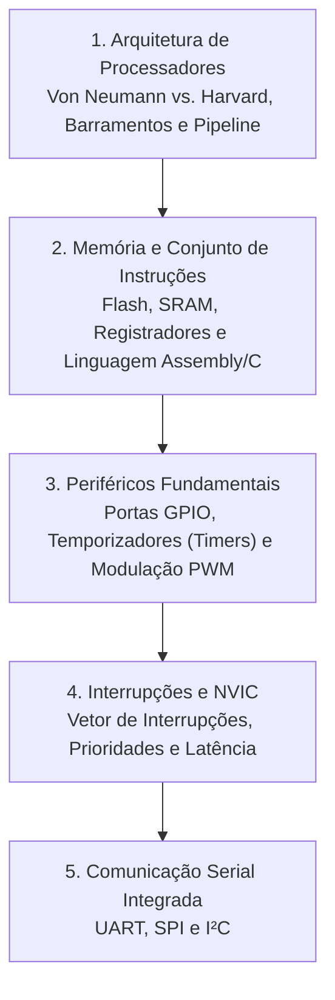

# TE328 - Microprocessadores e Microcontroladores

**Semestre:** 5º Semestre  
**Carga horária:** 60 h  
**Departamento:** Engenharia Elétrica - UFPR  

---

## 📚 Visão Geral da Disciplina

Estuda a arquitetura interna de computadores dedicados, conjunto de instruções (ISA RISC vs CISC), microcontroladores modernos (família ARM Cortex-M, STM32 e microcontroladores de 8/32 bits), periféricos integrados (GPIO, Timers, PWM, ADC/DAC) e sistemas de interrupção em tempo real.

---

## 📑 Principais Tópicos Teóricos

### 1. Arquiteturas de Computadores
* **Von Neumann:** Barramento compartilhado para instruções e dados (gargalo de Von Neumann).
* **Harvard:** Barramentos físicos independentes para memória de instruções (Flash) e de dados (SRAM), permitindo acesso simultâneo.

### 2. Tratamento de Interrupções
Ocorrências assíncronas externas (borda em pino GPIO) ou internas (estouro de timer) acionam a **Rotina de Serviço de Interrupção (ISR)**:
* Salvamento automático de contexto (registradores no Stack).
* Execução da ISR prioritária configurada no NVIC.
* Restauração do contexto e retorno ao programa principal.
