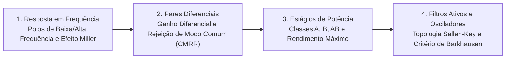

# TE329 - Eletrônica Analógica II

**Semestre:** 5º Semestre  
**Carga horária:** 60 h  
**Departamento:** Engenharia Elétrica - UFPR  

---

## 📚 Visão Geral da Disciplina

Eletrônica Analógica II aprofunda a análise de resposta em frequência de amplificadores transistorizados (efeito Miller e polos dominantes de alta e baixa frequência), pares diferenciais integrados, espelhos de corrente de precisão (Widlar, Wilson), estágios de potência de saída (Classes A, B, AB, C e D), filtros ativos (Butterworth, Chebyshev) e circuitos osciladores senoidais (ponte de Wien, Colpitts).

