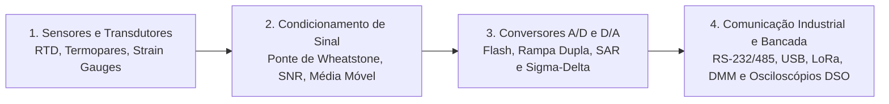
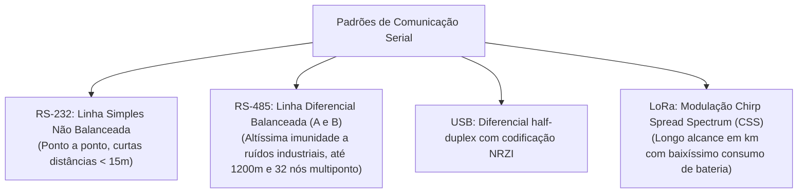

# TE331 - Instrumentação Eletrônica

**Semestre:** 5º Semestre  
**Carga horária:** 60 h  
**Departamento:** Engenharia Elétrica - UFPR  

---

## 📚 Visão Geral da Disciplina

Instrumentação Eletrônica estuda os princípios físicos dos transdutores e sensores (temperatura, pressão, deformação, deslocamento), o processamento analógico e digital de sinais com técnicas de cancelamento de ruído, a arquitetura e quantização de conversores A/D e D/A, e os padrões industriais de comunicação de dados e instrumentação de bancada.

---

## 📑 Principais Tópicos Teóricos

### 1. Processamento Estatístico e Redução de Ruído
* **Precisão vs. Exatidão:** A média aritmética de $N$ amostras reduz a variância do ruído aleatório gaussiano, elevando a relação sinal-ruído ($\text{SNR}$):
  $$
  \text{SNR}_{\text{ganho}} = 10 \log_{10}(N) \quad [\text{dB}]
  $$
  enquanto a **exatidão** depende estritamente da calibração metrológica contra um padrão rastreável.
* **Média Móvel:** Opera como um filtro digital passa-baixas sem distorcer o valor médio contínuo.
* **Sobre-amostragem (*Oversampling*):** Amostrar muito acima da taxa de Nyquist ($f_s \gg 2f_{\max}$) distribui o ruído de quantização em uma faixa de frequência maior; a filtragem digital e decimação subsequentes recuperam resolução efetiva (ganho em bits de resolução ENOB).

---

### 2. Conversores A/D (Analógico-Digital)

| Tipo de Conversor A/D | Velocidade de Conversão | Resolução Típica | Aplicações Típicas |
| :--- | :--- | :--- | :--- |
| **Flash (Paralelo)** | Ultrarrápida ($> 1\text{ GSPS}$) | Baixa/Média ($6 - 8\text{ bits}$) | Osciloscópios digitais (DSO), radares |
| **Aproximações Sucessivas (SAR)** | Rápida ($100\text{ kSPS} - 5\text{ MSPS}$) | Média/Alta ($10 - 18\text{ bits}$) | Microcontroladores (ESP32, STM32, PIC) |
| **Rampa Dupla (Dupla Integração)** | Lenta (~10 a 50 conversões/s) | Altíssima ($> 16 - 24\text{ bits}$) | Multímetros digitais de bancada (DMM) |
| **Sigma-Delta ($\Sigma\Delta$)** | Baixa/Média com oversampling | Altíssima ($16 - 24\text{ bits}$) | Áudio digital, sensores de precisão, balanças |

---

### 3. Interfaces de Comunicação em Instrumentação

---

### 4. Instrumentos Digitais de Medição
* **Multímetro Digital (DMM):** Converte grandezas alternadas (tensão/corrente CA) em CC via conversor *True RMS* antes do estágio do conversor A/D de rampa dupla.
* **Osciloscópio Digital (DSO):** O sinal analógico de entrada passa pelo circuito atenuador de alta frequência, é digitalizado pelo conversor Flash, armazenado na memória de aquisição circular de alta velocidade e só então renderizado na tela.
* **Analisador de Espectro:**
  * **Por Varredura (Super-heteródino):** Varia a frequência do oscilador local com filtro de frequência intermediária (IF) estreito e fixo.
  * **Por FFT:** Adquire os dados no domínio do tempo e processa a transformada rápida de Fourier, com resolução em frequência dada por $R_f = \frac{f_s}{N}$.
