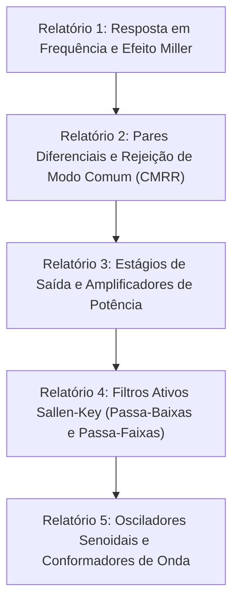

# TE332 - Laboratório de Eletrônica Analógica II

**Semestre:** 5º Semestre  
**Carga horária:** 30 h  
**Departamento:** Engenharia Elétrica - UFPR  

---

## 📚 Visão Geral da Disciplina

O Laboratório de Eletrônica Analógica II compreende atividades práticas de bancada dedicadas à implementação, teste e medição de circuitos integrados analógicos avançados: análise em frequência de amplificadores com transistores BJT/MOSFET, pares diferenciais com espelhos de corrente, amplificadores de potência (Classes A, B e AB), filtros ativos e circuitos conformadores de sinal.

---

## 📑 Relatórios Experimentais

Acesse os relatórios de bancada desenvolvidos:
* 📄 [Relatório 1 (R1)](R1.md)
* 📄 [Relatório 2 (R2)](R2.md)
* 📄 [Relatório 3 (R3)](R3.md)
* 📄 [Relatório 4 (R4)](R4.md)
* 📄 [Relatório 5 (R5)](R5.md)
