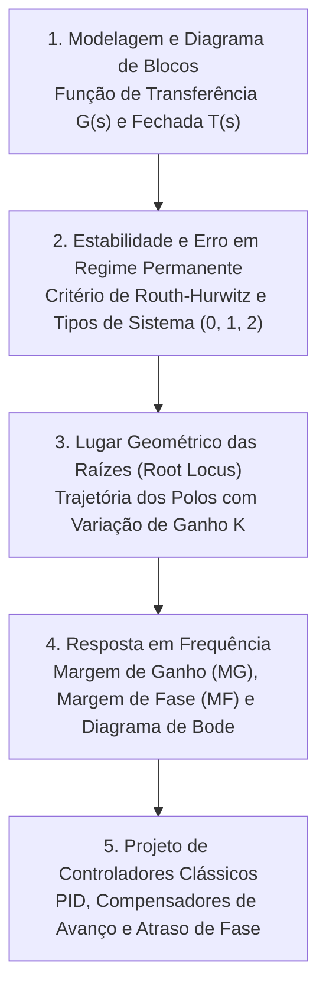

# TE334 - Sistemas Lineares de Controle

**Semestre:** 5º Semestre  
**Carga horária:** 60 h  
**Departamento:** Engenharia Elétrica - UFPR  

---

## 📚 Visão Geral da Disciplina

Sistemas Lineares de Controle estuda a teoria clássica de controle com realimentação: modelagem por função de transferência, análise de estabilidade absoluta (critério de Routh-Hurwitz) e relativa, análise de erros em regime permanente, projeto de compensadores de avanço e atraso de fase utilizando a técnica do Lugar Geométrico das Raízes (Root Locus) e resposta em frequência (Diagramas de Bode e Nyquist).

---

## 📑 Principais Tópicos Teóricos

### 1. Função de Transferência de Malha Fechada
Para um sistema com ganho direto $G(s)$ e realimentação $H(s)$:

$$
T(s) = \frac{Y(s)}{R(s)} = \frac{G(s)}{1 + G(s)H(s)}
$$

### 2. Estabilidade no Plano Complexo $s$
* **Estável:** Todos os polos de malha fechada situam-se estritamente no semiplano esquerdo ($\text{Re}(s) < 0$).
* **Marginalmente Estável:** Polos simples sobre o eixo imaginário $j\omega$.
* **Instável:** Pelo menos um polo no semiplano direito ($\text{Re}(s) > 0$).

### 3. Margens de Estabilidade no Diagrama de Bode
* **Margem de Fase (MF):** $\text{MF} = 180^\circ + \angle G(j\omega_{cg})$.
* **Margem de Ganho (MG):** $\text{MG} = -20 \log_{10}|G(j\omega_{cp})|$.
