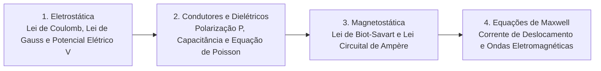

# TE369 - Eletricidade e Magnetismo

**Semestre:** 5º Semestre  
**Carga horária:** 60 h  
**Departamento:** Engenharia Elétrica - UFPR  

---

## 📚 Visão Geral da Disciplina

Eletricidade e Magnetismo aprofunda a teoria clássica de campos estáticos e variáveis no tempo. O curso cobre eletrostática no vácuo e em dielétricos, corrente estacionária, magnetostática no vácuo e em materiais magnéticos, indução eletromagnética e a síntese unificada das quatro Equações de Maxwell.

---

## 📑 As Equações de Maxwell na Forma Diferencial e Integral

| Lei Física | Forma Diferencial | Forma Integral | Significado Físico |
| :--- | :--- | :--- | :--- |
| **Lei de Gauss (Elétrica)** | $\nabla \cdot \vec{D} = \rho_v$ | $\oiint \vec{D} \cdot d\vec{S} = Q_{\text{env}}$ | Cargas elétricas são fontes de $\vec{D}$ |
| **Lei de Gauss (Magnética)** | $\nabla \cdot \vec{B} = 0$ | $\oiint \vec{B} \cdot d\vec{S} = 0$ | Inexistência de monopolos magnéticos |
| **Lei de Faraday** | $\nabla \times \vec{E} = -\frac{\partial \vec{B}}{\partial t}$ | $\oint \vec{E} \cdot d\vec{l} = -\frac{d\Phi_B}{dt}$ | Variação de $\vec{B}$ induz campo elétrico $\vec{E}$ |
| **Lei de Ampère-Maxwell** | $\nabla \times \vec{H} = \vec{J} + \frac{\partial \vec{D}}{\partial t}$ | $\oint \vec{H} \cdot d\vec{l} = I_{\text{env}} + \iint \frac{\partial \vec{D}}{\partial t} \cdot d\vec{S}$ | Corrente e $\frac{\partial \vec{D}}{\partial t}$ geram $\vec{H}$ |
