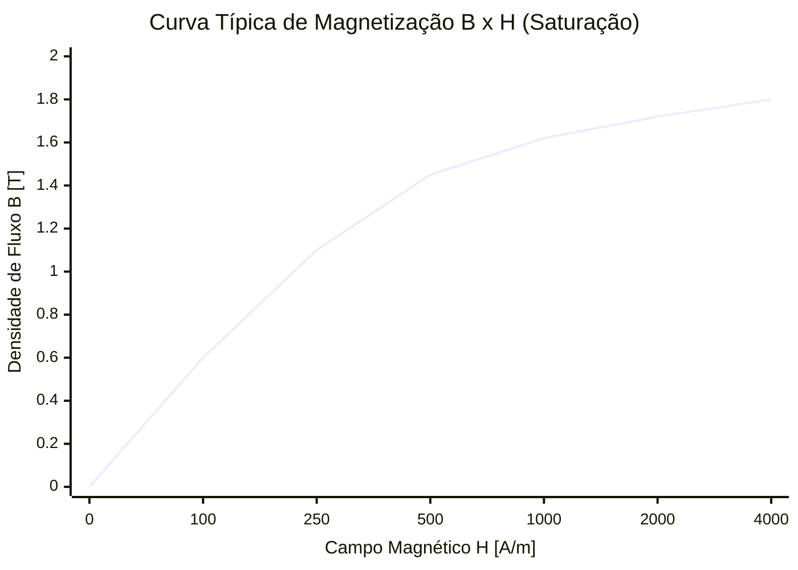

# Capítulo 2: Circuitos Magnéticos

Os circuitos magnéticos oferecem um modelo prático e aproximado para analisar o fluxo magnético em dispositivos eletromagnéticos (núcleos de ferro, relés, máquinas elétricas, reatores e transformadores), traçando uma analogia direta com os circuitos elétricos lineares (Lei de Ohm).

---

## 1. Analogia Eletromecânica / Magnética (Lei de Hopkinson)

A relação fundamental em circuitos magnéticos decorre da Lei Circuital de Ampère aplicada a materiais de alta permeabilidade:

| Grandeza Elétrica | Símbolo / Unidade | Grandeza Magnética | Símbolo / Unidade |
| :--- | :--- | :--- | :--- |
| **Força Eletromotriz (fem)** | $\mathcal{E}$ ou $V$ $[\text{V}]$ | **Força Magnetomotriz (fmm)** | $\mathcal{F} = N \cdot I$ $[\text{A}\cdot\text{e}]$ |
| **Corrente Elétrica** | $I$ $[\text{A}]$ | **Fluxo Magnético** | $\phi$ $[\text{Wb}]$ |
| **Resistência** | $R = \frac{l}{\sigma A}$ $[\Omega]$ | **Relutância** | $\mathcal{R} = \frac{l}{\mu A}$ $[\text{A}\cdot\text{e/Wb} \text{ ou } \text{H}^{-1}]$ |
| **Condutância** | $G = \frac{1}{R}$ $[\text{S}]$ | **Permeância** | $\mathcal{P} = \frac{1}{\mathcal{R}}$ $[\text{Wb/A}\cdot\text{e} \text{ ou } \text{H}]$ |
| **Condutividade** | $\sigma$ $[\text{S/m}]$ | **Permeabilidade** | $\mu = \mu_r \mu_0$ $[\text{H/m}]$ |
| **Densidade de Corrente** | $J = \frac{I}{A}$ $[\text{A/m}^2]$ | **Densidade de Fluxo** | $B = \frac{\phi}{A}$ $[\text{T}]$ |
| **Campo Elétrico** | $E = \frac{V}{l}$ $[\text{V/m}]$ | **Campo Magnético** | $H = \frac{\mathcal{F}}{l}$ $[\text{A}\cdot\text{e/m}]$ |

### Lei de Ohm Magnética (Lei de Hopkinson)

$$
\mathcal{F} = \phi \cdot \mathcal{R} \iff \phi = \frac{\mathcal{F}}{\mathcal{R}} = \frac{N \cdot I}{\mathcal{R}}
$$

Para um elemento ou segmento magnético de seção transversal $A_n$, comprimento médio $l_n$ e permeabilidade $\mu$:

$$
\mathcal{R}_n = \frac{l_n}{\mu \cdot A_n}
$$

onde $\mu = \mu_r \cdot \mu_0$ com $\mu_0 = 4\pi \times 10^{-7} \text{ H/m}$.

---

## 2. Leis de Kirchhoff para Circuitos Magnéticos

1. **Lei dos Nós Magnéticos:** A soma dos fluxos que entram em qualquer nó magnético é igual à soma dos fluxos que saem:
   $$
   \sum \phi_k = 0
   $$
2. **Lei das Malhas Magnéticas:** A soma algébrica das forças magnetomotrizes ($\sum N_k I_k$) ao longo de qualquer percurso fechado é igual à soma das quedas de potencial magnético ($\sum H_k l_k = \sum \phi_k \mathcal{R}_k$):
   $$
   \sum \mathcal{F} = \sum \mathcal{R}_k \phi_k \iff \oint \vec{H} \cdot d\vec{l} = \sum N_k I_k
   $$

---

## 3. Comprimento Médio do Núcleo ($l_c$) e Entreferros

### 3.1 Caminho Médio ($l_c$)
O comprimento médio representa o caminho geométrico central percorrido pelas linhas de fluxo fechadas no núcleo:

#### Exemplo Prático de Geometria Fechada:
Dado um núcleo retangular com dimensões externas de $8\text{ in} \times 10\text{ in}$ e pernas com espessura de $2\text{ in}$ (logo, $1\text{ in}$ para cada lado a partir do centro da janela):
* **Largura média:** $8\text{ in} - 1\text{ in} - 1\text{ in} = 6\text{ in}$
* **Altura média:** $10\text{ in} - 1\text{ in} - 1\text{ in} = 8\text{ in}$
* **Comprimento total ($l_c$):** $2 \times 6\text{ in} + 2 \times 8\text{ in} = 28\text{ in}$
* **Conversão para o SI:**
  $$
  1\text{ in} = 0{,}0254\text{ m} \implies l_c = 28 \times 0{,}0254 = 0{,}7112\text{ m}
  $$

> [!NOTE] Fatores Úteis de Conversão de Unidades:
> * $1\text{ in} = 0{,}0254\text{ m}$
> * $1\text{ cm}^2 = 10^{-4}\text{ m}^2 = 100\text{ mm}^2$
> * $1\text{ cm}^3 = 10^{-6}\text{ m}^3$

---

### 3.2 O Efeito do Entreferro (*Air Gap*)
Quando o núcleo possui um pequeno corte transversal de ar (entreferro) de comprimento $g$:
1. A permeabilidade do ar é $\mu_0 \ll \mu_{\text{núcleo}}$, logo a sua relutância $\mathcal{R}_g = \frac{g}{\mu_0 A_g}$ costuma predominar sobre a do ferro, mesmo para comprimentos milimétricos.
2. **Efeito de Espraiamento (*Fringing Effect*):** As linhas de campo se espalham nas bordas do entreferro, aumentando a área efetiva $A_g > A_{\text{núcleo}}$. Frequentemente corrige-se a área somando o comprimento do entreferro a cada dimensão da seção transversal: $A_g = (a + g)(b + g)$.

---

## 4. Núcleos Não-Lineares e Saturação

Na prática, materiais ferromagnéticos reais apresentam curvas de magnetização não-lineares ($B \times H$) com fenômeno de saturação e histerese.

### 4.1 Corrente de Pico ($I_{\text{pico}}$)
A corrente de pico na bobina ocorre no instante em que a densidade de fluxo atinge seu valor máximo ($B_{\max}$). Pela Lei de Ampère:

$$
N \cdot I_{\text{pico}} = H_{\max} \cdot l_c \implies I_{\text{pico}} = \frac{H_{\max} \cdot l_c}{N}
$$

onde $H_{\max}$ é obtido diretamente da curva $B-H$ ou tabela do fabricante correspondente a $B_{\max}$.

---

### 4.2 Corrente Eficaz ($I_{\text{rms}}$) em Excitação Não Linear
Devido à distorção harmônica e às perdas no ferro (histerese e correntes parasitas), a corrente de excitação real não é puramente senoidal. O cálculo da corrente eficaz ($I_{\text{rms}}$) emprega a **Potência Aparente Específica** ($S_{\text{esp}}$, dada em $\text{VA/kg}$ ou $\text{VA/lb}$) tabelada para a densidade de fluxo de operação:

$$
S = S_{\text{esp}} \times M_{\text{núcleo}} \quad [\text{VA}]
$$

Com a potência aparente de magnetização conhecida:

$$
S = V_{\text{rms}} \cdot I_{\text{rms}} \implies I_{\text{rms}} = \frac{S}{V_{\text{rms}}}
$$

#### Exemplo Passo a Passo (Aço Silício M-19):
1. **Volume geométrico do núcleo:**
   $$
   V_{\text{geo}} = A_{\text{geo}} \cdot l_c = 0{,}00258\text{ m}^2 \times 0{,}7112\text{ m} = 1{,}835 \times 10^{-3}\text{ m}^3
   $$
2. **Volume efetivo de aço** (considerando fator de empilhamento / laminação de $0{,}94$):
   $$
   V_{\text{aço}} = 0{,}94 \times 1{,}835 \times 10^{-3} = 1{,}725 \times 10^{-3}\text{ m}^3
   $$
3. **Massa do núcleo** (densidade $\rho = 7650\text{ kg/m}^3$):
   $$
   M = \rho \cdot V_{\text{aço}} = 7650 \times 1{,}725 \times 10^{-3} = 13{,}2\text{ kg} \approx 29{,}04\text{ lb}
   $$
4. **Potência aparente total:**
   Se a tabela do aço fornece $18\text{ VA/lb}$ para a indução máxima solicitada:
   $$
   S = 18 \times 29{,}04 = 522{,}72\text{ VA}
   $$
5. **Corrente eficaz requerida:**
   $$
   I_{\text{rms}} = \frac{S}{V_{\text{rms}}}
   $$

*(Consulte a resolução completa no arquivo [Listas Resolvidas](Listas%20Resolvidas.md#resolução-dos-exercícios-dos-slides)).*

---

## 5. Força de Sustentação / Elevação de um Eletroímã

A força mecânica exercida por um campo magnético na interface entre o núcleo ferromagnético e uma armadura móvel decorre da taxa de variação da energia co-magnética em relação ao deslocamento:

$$
F = \frac{d W_m}{dx}
$$

Para um entreferro com densidade de fluxo uniforme $B$ e área de contato total $A$:

$$
F = \frac{B^2 \cdot A}{2\mu_0} \quad [\text{N}]
$$

Se o fluxo magnético for produzido por uma bobina de $N$ espiras conduzindo corrente $I$ através de um circuito de comprimento médio total $l$:

$$
B = \frac{\mu \cdot N \cdot I}{l}
$$

Substituindo $B$ na equação da força de atração:

$$
F = \frac{\left(\frac{\mu N I}{l}\right)^2 A}{2\mu} = \frac{\mu \cdot N^2 \cdot I^2 \cdot A}{2 l^2} \quad [\text{N}]
$$

> [!TIP]
> Caso existam dois polos de contato em série (formando um circuito magnético em "U"), a força total é a soma das forças desenvolvidas em ambas as faces de contato ($2 \times F_{\text{polo}}$).
