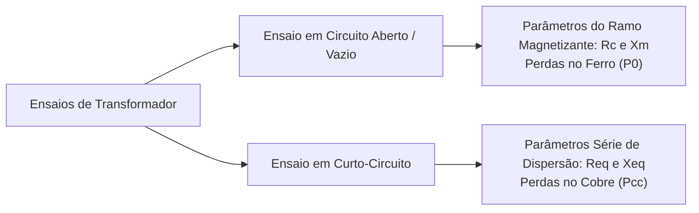

# Capítulo 4: Ensaios Elétricos, Regulação de Tensão e Rendimento

A determinação experimental dos parâmetros do circuito equivalente e a avaliação do comportamento sob carga de um transformador são fundamentais para o projeto e especificação em sistemas de energia.

---

## 1. Ensaios Elétricos de Transformadores

Os quatro parâmetros principais do circuito equivalente ($R_{eq}$, $X_{eq}$, $R_c$, $X_m$) são obtidos através de dois ensaios clássicos padronizados:

---

### 1.1 Ensaio em Circuito Aberto (Ensaio a Vazio)

* **Objetivo:** Determinar a impedância de excitação ($R_c, X_m$) e as perdas no ferro ($P_0 = P_{\text{núcleo}}$).
* **Conexão Típica:** Alimenta-se o lado de **baixa tensão (BT)** com a tensão nominal $V_n$, mantendo o enrolamento de alta tensão (AT) aberto por motivos de segurança e facilidade operacional na bancada.

#### Grandezas Medidas:
* $V_0 = V_{\text{nominal}}$ (Voltímetro)
* $I_0 = I_{\text{vazio}}$ (Amperímetro — tipicamente $1\%$ a $5\%$ da corrente nominal)
* $P_0 = P_{\text{vazio}}$ (Wattímetro — mede exclusivamente perdas no núcleo, pois a perda Joule $I_0^2 R_1 \approx 0$)

#### Dedução dos Parâmetros:
1. **Fator de potência a vazio:**
   $$
   \cos(\varphi_0) = \frac{P_0}{V_0 \cdot I_0}
   $$
2. **Decomposição da corrente de excitação:**
   * Componente ativa (perdas no ferro):
     $$
     I_c = I_0 \cos(\varphi_0) = \frac{P_0}{V_0}
     $$
   * Componente reativa (magnetização):
     $$
     I_m = I_0 \operatorname{sen}(\varphi_0) = \sqrt{I_0^2 - I_c^2}
     $$
3. **Resistência de perdas no núcleo e reatância de magnetização:**
   $$
   R_c = \frac{V_0}{I_c} = \frac{V_0^2}{P_0}
   $$
   $$
   X_m = \frac{V_0}{I_m}
   $$

---

### 1.2 Ensaio em Curto-Circuito

* **Objetivo:** Determinar a resistência equivalente dos enrolamentos ($R_{eq}$), a reatância equivalente de dispersão ($X_{eq}$) e as perdas nominais no cobre ($P_{cc}$).
* **Conexão Típica:** Aplica-se curto-circuito franco nos terminais de **baixa tensão (BT)** e alimenta-se o enrolamento de **alta tensão (AT)** com uma tensão gradualmente elevada até que a corrente circulante atinja o valor nominal $I_n$.

#### Grandezas Medidas:
* $V_{cc}$ (Voltímetro — fração pequena da tensão nominal, tipicamente $2\%$ a $8\%$ de $V_n$)
* $I_{cc} = I_{\text{nominal}}$ (Amperímetro)
* $P_{cc}$ (Wattímetro — perdas Joule totais nos condutores)

> [!NOTE]
> Como $V_{cc}$ é muito reduzida, o fluxo no núcleo é insignificante ($B \ll B_n$), tornando as perdas no ferro desprezíveis neste ensaio. O ramo em paralelo ($R_c \parallel jX_m$) é omitido do circuito equivalente do ensaio.

#### Dedução dos Parâmetros:
1. **Módulo da impedância equivalente referida ao lado do ensaio:**
   $$
   Z_{eq} = \frac{V_{cc}}{I_{cc}}
   $$
2. **Resistência equivalente total:**
   $$
   R_{eq} = \frac{P_{cc}}{I_{cc}^2}
   $$
3. **Reatância equivalente de dispersão:**
   $$
   X_{eq} = \sqrt{Z_{eq}^2 - R_{eq}^2}
   $$
4. **Separação aproximada entre primário e secundário:**
   Em projetos otimizados de transformadores de potência, as perdas Joule são igualmente distribuídas entre os enrolamentos ($I_1^2 R_1 \approx I_2^2 R_2$):
   $$
   R_1 \approx \frac{R_{eq1}}{2}, \quad R_2 \approx \frac{R_{eq1}}{2 a^2}
   $$
   $$
   X_1 \approx \frac{X_{eq1}}{2}, \quad X_2 \approx \frac{X_{eq1}}{2 a^2}
   $$

---

## 2. Impedância Percentual ($Z\%$) e Corrente de Curto-Circuito

A impedância percentual $Z(\%)$ expressa a queda de tensão interna na impedância série quando percorrida pela corrente nominal, em relação à tensão nominal:

$$
Z(\%) = \frac{V_{cc}}{V_n} \times 100 = \frac{Z_{eq} \cdot I_n}{V_n} \times 100
$$

### Impedância Ôhmica a Partir dos Dados de Placa
Conhecendo a potência nominal $S_n$, a tensão nominal de linha $V_n$ e o valor de $Z\%$:

$$
Z_t = \left(\frac{V_n^2}{S_n}\right) \cdot \frac{Z(\%)}{100} \quad [\Omega]
$$

### Corrente de Curto-Circuito Simétrica Estimada ($I_{cc}$)
No caso de um curto-circuito trifásico nos terminais secundários mantendo a tensão nominal na barra de alimentação:

$$
I_{cc} = \frac{V_L}{\sqrt{3} \cdot Z_t} = \frac{I_n}{\frac{Z(\%)}{100}}
$$

> [!IMPORTANT]
> A impedância percentual define a corrente de curto-circuito que as proteções (disjuntores, fusíveis) e os barramentos devem suportar termicamente e dinamicamente. Um trafo com $Z = 5\%$ tem $I_{cc} = 20 \times I_n$.

---

## 3. Regulação de Tensão ($\Delta V\%$)

A regulação de tensão mede a variação da tensão nos terminais do secundário entre a condição em vazio (sem carga) e a plena carga:

$$
\text{Reg}(\%) = \frac{|\dot{V}_{2,\text{vazio}}| - |\dot{V}_{2,\text{carga}}|}{|\dot{V}_{2,\text{carga}}|} \times 100
$$

Referindo as grandezas ao lado primário (onde em vazio $V_2' = V_1$):

$$
\text{Reg}(\%) = \frac{V_1 - a V_2}{a V_2} \times 100 = \frac{V_1 - V_2'}{V_2'} \times 100
$$

### Relação com o Fator de Potência da Carga:
* **Carga Indutiva ($\cos\varphi$ atrasado):** A queda de tensão em $R_{eq}$ e $X_{eq}$ reduz $V_2$ ($\text{Reg} > 0$).
* **Carga Resistiva pura ($\cos\varphi = 1$):** Regulação ligeiramente positiva, decorrente da perda resistiva.
* **Carga Capacitiva ($\cos\varphi$ adiantado):** Ocorre o efeito de elevação de tensão nos terminais (efeito Ferranti em pequena escala no transformador), podendo fazer $\text{Reg} \le 0$ ($V_2 > V_{2,\text{vazio}}$).

---

## 4. Rendimento ($\eta$)

O rendimento expressa a razão entre a potência ativa útil fornecida à carga e a potência ativa total absorvida da rede:

$$
\eta = \frac{P_{\text{saída}}}{P_{\text{entrada}}} = \frac{P_{\text{saída}}}{P_{\text{saída}} + P_{\text{perdas}}}
$$

As perdas totais são a soma das perdas no cobre (variáveis com a carga) e perdas no núcleo (constantes):

$$
P_{\text{perdas}} = P_{\text{núcleo}} + P_{\text{cobre}} = P_0 + \left(\frac{I_2}{I_{2n}}\right)^2 P_{cc}
$$

Para uma carga com fator de potência $\cos\varphi$ operando a uma fração de carregamento $k = \frac{I_2}{I_{2n}} = \frac{S}{S_n}$:

$$
\eta(\%) = \frac{k \cdot S_n \cdot \cos\varphi}{k \cdot S_n \cdot \cos\varphi + P_0 + k^2 P_{cc}} \times 100
$$

> [!TIP] Condição de Máximo Rendimento:
> O rendimento máximo de um transformador ocorre no ponto em que as perdas variáveis no cobre igualam as perdas constantes no núcleo:
> $$
> k^2 P_{cc} = P_0 \implies k_{\eta_{\max}} = \sqrt{\frac{P_0}{P_{cc}}}
> $$
