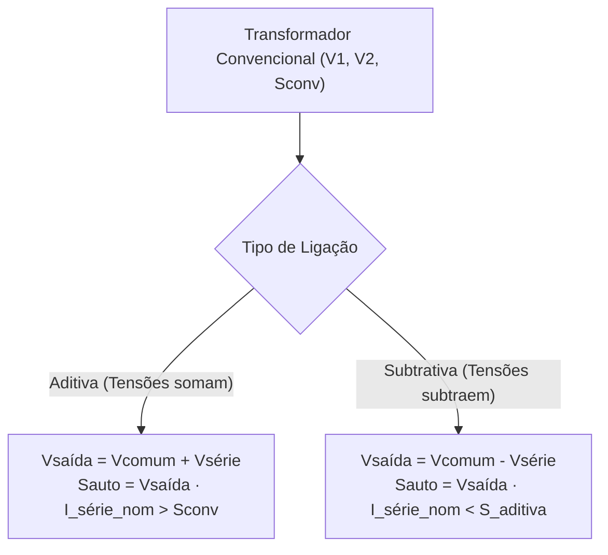

# Capítulo 5: Operação em Paralelo, Autotransformadores e Sistemas Trifásicos

Este capítulo abrange configurações avançadas de transformadores: a conexão em paralelo para expansão de capacidade, o autotransformador monofásico (com transferências condutiva e indutiva de potência) e relações de defasagem angular em sistemas trifásicos.

---

## 1. Operação em Paralelo de Transformadores

Dois ou mais transformadores operam em paralelo quando seus enrolamentos primários estão conectados a uma mesma barra de alimentação e seus secundários alimentam uma mesma barra de carga.

### 1.1 Condições Rigorosas para Ligação em Paralelo
Para evitar sobrecargas prematuras, aquecimentos excessivos e correntes de circulação destrutivas:
1. **Mesma Relação de Transformação ($a_A = a_B$):** Mesmas tensões nominais primárias e secundárias.
2. **Mesma Polaridade e Deslocamento Angular:** A mesma defasagem fasorial entre primário e secundário (essencial em bancos trifásicos: mesmo grupo de ligação, ex: Dyn11 com Dyn11).
3. **Mesma Impedância Percentual em Base Comum ($Z\%_A = Z\%_B$):** Garante a divisão de carga estritamente proporcional às potências nominais individuais ($S_A$ e $S_B$).
4. **Mesma Relação $\frac{X_{eq}}{R_{eq}}$:** Evita circulação de correntes reativas indesejadas entre unidades.

### 1.2 Corrente de Circulação ($I_{\text{circ}}$)
Se houver uma pequena discrepância entre as relações de transformação ($a_A \neq a_B$), as tensões induzidas em vazio secundárias serão desiguais ($E_{2a} \neq E_{2b}$), originando uma corrente circulante interna mesmo com a barra de carga desligada:

$$
\dot{I}_{\text{circ}} = \frac{\dot{E}_{2a} - \dot{E}_{2b}}{\dot{Z}_{eq,a} + \dot{Z}_{eq,b}}
$$

> [!WARNING]
> Como as impedâncias internas $Z_{eq}$ são muito pequenas, uma diferença de apenas $1\%$ a $2\%$ nas tensões induzidas pode provocar correntes de circulação que consomem grande parte da capacidade térmica nominal dos enrolamentos.

---

## 2. Autotransformadores

O autotransformador é um transformador no qual os enrolamentos primário e secundário compartilham fisicamente espiras em um único circuito magnético, proporcionando conexão condutiva direta entre eles.

### 2.1 Vantagens e Desvantagens em Relação ao Trafo Convencional
* **Vantagens:** Menor tamanho e peso, menor custo de fabricação, maior rendimento (menores perdas no ferro e cobre), menor regulação de tensão (menor impedância equivalente).
* **Desvantagem:** **Perda da isolação galvânica** entre alta e baixa tensão (uma sobretensão na alta reflete-se diretamente na baixa tensão).

---

### 2.2 Configuração Abaixadora vs. Elevadora

#### Autotransformador Abaixador:
A alta tensão ($V_A$) é aplicada sobre a totalidade das espiras em série ($N_1 + N_2$), e a carga em baixa tensão ($V_B$) é conectada sobre as espiras comuns ($N_2$).

$$
\frac{V_A}{V_B} = \frac{E_1 + E_2}{E_2} = \frac{N_1 + N_2}{N_2} = 1 + \frac{N_1}{N_2}
$$

#### Autotransformador Elevador:
A baixa tensão ($V_B$) alimenta o enrolamento comum ($N_1$), e a alta tensão de saída ($V_A$) é obtida pela associação em série.

$$
\frac{V_A}{V_B} = \frac{E_1 + E_2}{E_1} = \frac{N_1 + N_2}{N_1} = 1 + \frac{N_2}{N_1}
$$

---

### 2.3 Potência Aparente e Transferência de Potência

A potência aparente nominal total de um autotransformador é muito superior à capacidade do mesmo enrolamento operando como transformador de dois enrolamentos convencional:

$$
S_{\text{auto}} = V_{\text{saída}} \cdot I_{\text{saída}}
$$

A potência transferida à carga no autotransformador é subdividida em duas parcelas:
1. **Potência Indutiva ou Transformada ($S_{\text{ind}} = S_{\text{conv}}$):** Transferida via fluxo magnético pelo núcleo.
2. **Potência Condutiva ($S_{\text{cond}}$):** Transferida diretamente por condução elétrica através da ligação física dos enrolamentos.

$$
S_{\text{auto}} = S_{\text{ind}} + S_{\text{cond}}
$$

A relação de amplificação de potência aparente em uma conexão aditiva padrão é:

$$
\frac{S_{\text{auto}}}{S_{\text{conv}}} = 1 + \frac{V_{\text{comum}}}{V_{\text{série}}} = \frac{a_{\text{auto}}}{a_{\text{auto}} - 1}
$$

---

## 3. Análise Crítica: Ligação Aditiva vs. Subtrativa

A capacidade de potência entregue por um autotransformador depende diretamente de:
1. Qual enrolamento está em **série com a linha**.
2. Se as polaridades instantâneas das tensões nas bobinas se **somam (aditiva)** ou se **subtraem (subtrativa)**.

### 3.1 Regra Fundamental Limitada pela Corrente Térmica
A potência máxima contínua do autotransformador sem queimar o isolamento é rigidamente limitada pela **corrente nominal da bobina conectada em série**:

$$
I_{\text{série\_nom}} = \frac{S_{\text{conv}}}{V_{\text{série}}}
$$

$$
S_{\text{auto}} = V_{\text{saída}} \cdot I_{\text{série\_nom}}
$$

---

### 3.2 Comparação Numérica Prática (Trafo $10\text{ kVA}$, $1200\text{ V} / 120\text{ V}$)

* Corrente nominal do enrolamento de $120\text{ V}$:
  $$
  I_{120\text{V}} = \frac{10000}{120} = 83{,}33\text{ A}
  $$

#### Caso A: Ligação Aditiva (Tensões se somam)
* Tensão de saída: $V_{\text{saída}} = 1200\text{ V} + 120\text{ V} = 1320\text{ V}$
* Potência total disponível:
  $$
  S_{\text{auto}} = 1320\text{ V} \times 83{,}33\text{ A} = 110\text{ kVA}
  $$
  *(Houve uma multiplicação de $11\times$ da capacidade nominal do transformador).*

#### Caso B: Ligação Subtrativa (Tensões se subtraem)
* Tensão de saída: $V_{\text{saída}} = 1200\text{ V} - 120\text{ V} = 1080\text{ V}$
* Como a corrente máxima do enrolamento em série permanece $83{,}33\text{ A}$:
  $$
  S_{\text{auto}} = 1080\text{ V} \times 83{,}33\text{ A} = 90\text{ kVA}
  $$

> [!CAUTION] Cuidado com Fórmulas Prontas:
> A fórmula simplificada $S_{\text{auto}} = S_{\text{conv}} \cdot (1 + \frac{V_c}{V_s})$ só é válida para a polaridade aditiva. Para ligações subtrativas, a abordagem infalível é sempre calcular pela corrente térmica nominal admissível do enrolamento em série.

---

## 4. Notas sobre Sistemas Trifásicos e Relações de Fase

Em transformadores trifásicos e bancos de transformadores monofásicos com sequência positiva de fases ($A-B-C$):

### Conexão Estrela ($Y$):
* As correntes de linha e fase são idênticas: $I_L = I_{\text{fase}}$.
* A tensão de linha adianta a tensão de fase em $+30^\circ$ e possui módulo $\sqrt{3}$ vezes maior:
  $$
  \dot{V}_{L} = \sqrt{3} \cdot V_{\text{fase}} \angle +30^\circ
  $$

### Conexão Triângulo ($\Delta$):
* A tensão de linha e fase são idênticas: $V_L = V_{\text{fase}}$.
* A corrente de linha atrasa a corrente de fase em $-30^\circ$ e possui módulo $\sqrt{3}$ vezes maior:
  $$
  \dot{I}_{L} = \sqrt{3} \cdot I_{\text{fase}} \angle -30^\circ
  $$
