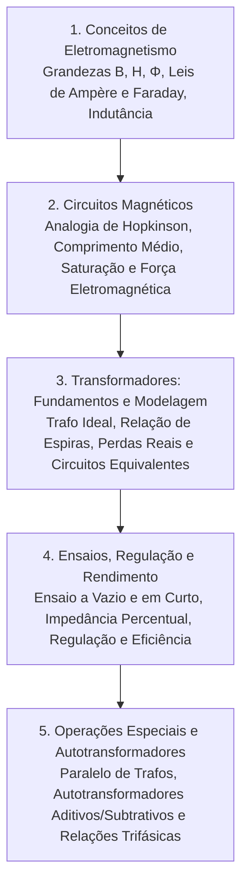

# TE323 - Conversão de Energia I

**Período/Ano:** 2° Semestre/2026  
**Links Rápidos:**
* 📘 [NotebookLM da disciplina](https://notebook.google.com/notebook/ae8458fc-770c-44d1-8b6b-5e952b079b1d)
* 📝 [Listas e Exercícios Resolvidos](Listas%20Resolvidas.md)

---

## 📚 Ementa e Conteúdo Programático

A disciplina aborda a teoria do campo magnético aplicada à conversão estática e dinâmica de energia, o estudo aprofundado dos circuitos magnéticos com núcleo ferromagnético e a modelagem, ensaios e operação de transformadores de potência e autotransformadores.

Os conteúdos foram organizados na sequência lógica de estudo abaixo:

---

## 📑 Módulos da Disciplina

### [Capítulo 1: Conceitos Fundamentais de Eletromagnetismo](Capítulo%201%20Conceitos%20de%20Eletromagnetismo.md)
* Grandezas fundamentais: $B$, $H$, $\phi$, $\lambda$ e permeabilidade magnética ($\mu = \mu_r \mu_0$).
* Leis de Ampère e Faraday-Lenz.
* Indutância própria ($L = N^2 / \mathcal{R}$) e densidade de energia magnética acumulada ($w_m = \frac{1}{2} B H$).

### [Capítulo 2: Circuitos Magnéticos](Capítulo%202%20Circuitos%20Magnéticos.md)
* Analogia elétrica-magnética (Lei de Hopkinson: $\mathcal{F} = \phi \mathcal{R}$).
* Cálculo do comprimento médio do núcleo ($l_c$), janela e área efetiva com fator de empilhamento.
* Efeito do entreferro (*air gap*) e espraiamento (*fringing effect*).
* Núcleos não lineares, corrente de pico ($I_{\text{pico}}$) e corrente eficaz ($I_{\text{rms}}$) com tabelas de aço.
* Força eletromagnética de sustentação/elevação em eletroímãs ($F = \frac{B^2 A}{2\mu_0}$).

### [Capítulo 3: Transformadores de Energia — Fundamentos e Modelagem](Capítulo%203%20Transformadores%20de%20Energia.md)
* Princípio de funcionamento e transformador ideal (relações de tensão, corrente e reflexão de impedância $a^2$).
* Equação geral da f.e.m. induzida ($E_{\text{rms}} = 4{,}44 f N \phi_{\max}$).
* Fenômenos no transformador real: perdas no cobre, dispersão de fluxo e ramo magnetizante ($I_m$ e $I_c$).
* Circuitos equivalentes exato, aproximado e referidos (ao primário e ao secundário).
* Diagramas e equacionamento fasorial das tensões nos enrolamentos.

### [Capítulo 4: Ensaios Elétricos, Regulação de Tensão e Rendimento](Capítulo%204%20Ensaios%20Regulação%20e%20Rendimento.md)
* **Ensaio a Vazio / Circuito Aberto:** Levantamento de $R_c$, $X_m$ e perdas no núcleo ($P_0$).
* **Ensaio em Curto-Circuito:** Levantamento de $R_{eq}$, $X_{eq}$ e perdas no cobre ($P_{cc}$).
* Impedância percentual ($Z\%$) e determinação da corrente de curto-circuito simétrica ($I_{cc}$).
* Regulação de tensão percentual ($\text{Reg}\%$) e impacto do fator de potência da carga (indutiva vs capacitiva).
* Rendimento ($\eta$) e condição ótima de operação para rendimento máximo ($k_{\eta_{\max}} = \sqrt{P_0 / P_{cc}}$).

### [Capítulo 5: Operação em Paralelo, Autotransformadores e Sistemas Trifásicos](Capítulo%205%20Operações%20Especiais%20e%20Autotransformadores.md)
* Condições e critérios para operação de transformadores em paralelo e cálculo da corrente de circulação ($I_{\text{circ}}$).
* Autotransformadores abaixadores e elevadores: relações de espiras e tensões.
* Transferência mista de potência: parcela indutiva ($S_{\text{ind}}$) vs parcela condutiva ($S_{\text{cond}}$).
* Análise aprofundada de **ligações aditivas vs subtrativas** e limitação por corrente térmica.
* Relações e defasagens de $30^\circ$ em conexões trifásicas ($Y$ e $\Delta$).

---

## 📂 Material Complementar e Exercícios
* [Listas e Exercícios Resolvidos](Listas%20Resolvidas.md): Resoluções passo a passo de exercícios dos slides e listas de transformadores da P1.