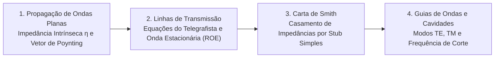

# TE338 - Ondas Eletromagnéticas

**Semestre:** 6º Semestre  
**Carga horária:** 60 h  
**Departamento:** Engenharia Elétrica - UFPR  
**Página Oficial:** [eletrica.ufpr.br/cadartora/TE338.htm](https://www.eletrica.ufpr.br/cadartora/TE338.htm)  
**Materiais de Apoio:** [Provas e Listas Antigas](provas-antigas.md)

---

## 📚 Visão Geral da Disciplina

Ondas Eletromagnéticas trata da propagação de ondas guiadas e em espaço livre: equações de onda em meios condutores e dielétricos, reflexão e refração com incidência oblíqua, teoria distribuída das Linhas de Transmissão (LT), casamento de impedâncias via Carta de Smith (*Smith Chart*), guias de ondas metálicos retangulares e introdução a antenas e radiação.

---

## 📑 Principais Tópicos Teóricos

### 1. Propagação e Vetor de Poynting
A densidade de potência instantânea transportada pela onda eletromagnética é dada pelo **Vetor de Poynting**:

$$
\vec{S} = \vec{E} \times \vec{H} \quad [\text{W/m}^2]
$$

### 2. Teoria Distribuída de Linhas de Transmissão
* **Impedância Característica:**
  $$
  Z_0 = \sqrt{\frac{R' + j\omega L'}{G' + j\omega C'}} \xrightarrow{\text{sem perdas}} \sqrt{\frac{L'}{C'}} \quad [\Omega]
  $$
* **Coeficiente de Reflexão na Carga:**
  $$
  \Gamma_L = \frac{Z_L - Z_0}{Z_L + Z_0} = |\Gamma| e^{j\theta}
  $$
* **Razão de Onda Estacionária (ROE / VSWR):**
  $$
  \text{ROE} = \frac{1 + |\Gamma|}{1 - |\Gamma|} \quad (1 \le \text{ROE} < \infty)
  $$
