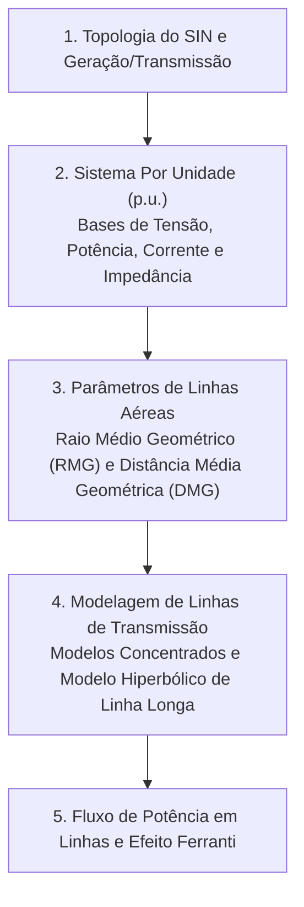

# TE339 - Sistemas Elétricos de Potência I

**Semestre:** 6º Semestre  
**Carga horária:** 60 h  
**Departamento:** Engenharia Elétrica - UFPR  

---

## 📚 Visão Geral da Disciplina

Sistemas Elétricos de Potência I estuda a estrutura do Sistema Interligado Nacional (SIN), o sistema de unidades Por Unidade ($pu$), o cálculo dos parâmetros elétricos das Linhas de Transmissão aéreas (resistência com efeito pelicular, indutância com raio médio geométrico RMG e capacitância com método das imagens), e os modelos de linhas curtas, médias (circuito $\pi$) e longas com reflexão hiperbólica.

---

## 📑 Principais Tópicos Teóricos

### 1. Sistema Por Unidade ($pu$)
Permite normalizar grandezas de diferentes níveis de tensão transformados no mesmo sistema elétrico:

$$
S_{\text{base}} = \text{constante em todo o sistema (ex: 100 MVA)}
$$
$$
Z_{\text{base}} = \frac{V_{\text{base}}^2}{S_{\text{base}}}, \quad I_{\text{base}} = \frac{S_{\text{base}}}{\sqrt{3} V_{\text{base}}}
$$
Mudança de base de impedância:

$$
Z_{pu,\text{novo}} = Z_{pu,\text{velho}} \cdot \left(\frac{V_{\text{base,velho}}}{V_{\text{base,novo}}}\right)^2 \cdot \left(\frac{S_{\text{base,novo}}}{S_{\text{base,velho}}}\right)
$$

### 2. Parâmetros de Linhas de Transmissão
* **Indutância de Linha Trifásica Transposta:**
  $$
  L = 2 \times 10^{-7} \ln\left(\frac{\text{DMG}}{\text{RMG}}\right) \quad [\text{H/m/fase}]
  $$
  onde $\text{DMG} = \sqrt[3]{D_{ab} D_{bc} D_{ca}}$ e $\text{RMG}$ é o Raio Médio Geométrico dos condutores/feixes.

### 3. Modelo $\pi$ de Linha Média ($80\text{ km} \le d \le 250\text{ km}$)
* Impedância série total: $Z = z \cdot d$.
* Admitância shunt capacitiva dividida igualmente nas extremidades: $\frac{Y}{2} = j \frac{\omega C \cdot d}{2}$.
* **Efeito Ferranti:** Elevação da tensão no terminal receptor da linha quando operando a vazio ou com carga muito leve ($V_R > V_S$).
