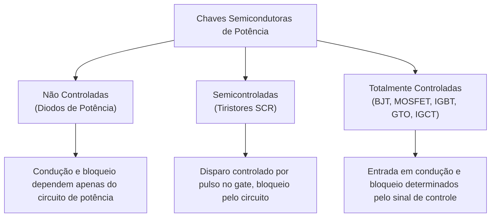
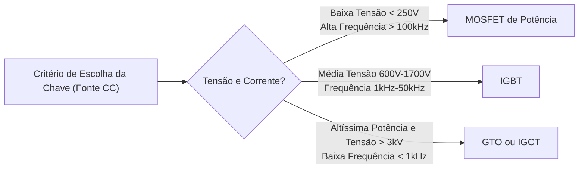

# Capítulo 1: Dispositivos Semicondutores de Potência e Comutação

A **Eletrônica de Potência** dedica-se ao processamento e controle eficiente da energia elétrica através da comutação de dispositivos semicondutores em estado sólido. O objetivo central é converter uma fonte de energia com características dadas (tensão, corrente, frequência) em uma saída controlada com o mínimo possível de dissipação térmica interna ($\eta \to 100\%$).

---

## 1. Classificação Geral das Chaves Semicondutoras

Ao contrário da eletrônica de sinal (onde transistores operam na região ativa/linear para amplificação), na eletrônica de potência os semicondutores operam predominantemente como **chaves binárias** (corte ou saturação):
* **Estado Aberto (Bloqueio / *OFF*):** Tensão elevada entre terminais e corrente de fuga praticamente nula ($P_{\text{off}} \approx 0$).
* **Estado Fechado (Condução / *ON*):** Corrente elevada circulando e queda de tensão direta reduzida ($V_{\text{on}}$ pequena, resultando em baixas perdas de condução).

---

## 2. Família dos Tiristores

Um tiristor é um dispositivo semicondutor multicamada ($p-n-p-n$) com comportamento biestável.

### 2.1 Tiristor Controlado por Fase (SCR - *Silicon Controlled Rectifier*)
* **Entrada em condução (Disparo):** Requer polarização direta ($V_{AK} > 0$) associada a um pulso de corrente positivo de curta duração no terminal da porta (*gate*, $I_G > I_{GT}$).
* **Condição de travamento:** A corrente de anodo deve superar a corrente de travamento (*latching current*, $I_L$) antes que o pulso de disparo cesse.
* **Bloqueio (Desligamento):** Uma vez em condução, a porta **perde o controle**. O SCR só bloqueia quando a corrente de anodo cai abaixo da **corrente de manutenção** (*holding current*, $I_H$) por tempo suficiente para que as cargas espaciais se recombinem ($t_q$ — tempo de recuperação inversa).

---

### 2.2 Tipos Principais de Tiristores e Características de Comando

| Dispositivo | Nome Técnico | Mecanismo de Disparo (*Turn-on*) | Mecanismo de Bloqueio (*Turn-off*) | Aplicações Típicas |
| :--- | :--- | :--- | :--- | :--- |
| **SCR** | Tiristor Clássico | Pulso $+I_G$ (com $V_{AK} > 0$) | Comutação natural ou forçada ($I_A < I_H$) | Retificação industrial, linhas HVDC |
| **TRIAC** | Triodo Bidirecional | Pulso no gate (+ ou -) em ambos sentidos | Passagem da corrente por zero em CA | Dimmers, controle de motores CA residenciais |
| **GTO** | *Gate Turn-Off Thyristor* | Pulso $+I_G$ de curta duração | Pulso negativo intenso no gate ($-I_G \approx \frac{I_A}{3} \text{ a } \frac{I_A}{5}$) | Tração elétrica pesada, média tensão |
| **IGCT** | *Integrated Gate-Commutated Thyristor* | Pulso $+I_G$ com circuito integrado | Bloqueio ultrarrápido por desvio total da corrente catódica | Inversores industriais de média tensão (MW) |
| **MTO** | *MOS-Turn-Off Thyristor* | Pulso $+I_G$ no anodo/gate | Pulso de tensão na porta do MOSFET auxiliar interno | Compensadores estáticos (STATCOM), drives industriais |
| **ETO** | *Emitter Turn-Off Thyristor* | Tensão positiva nas duas portas | Tensão negativa no emissor via MOSFET integrado | Sistemas FACTS e transmissão flexível |
| **LASCR** | *Light-Activated SCR* | Pulso óptico (feixe de laser/fibra) | Comutação natural / queda de corrente | Válvulas de tiristores em alta tensão (HVDC) |

---

## 3. Transistores de Potência: BJT, MOSFET e IGBT

Quando a frequência de chaveamento precisa ser elevada (kHz a centenas de kHz), os transistores superam os tiristores tradicionais:

### 3.1 MOSFET de Potência (*Metal-Oxide-Semiconductor FET*)
* **Acionamento:** Controlado por **tensão na porta** ($V_{GS}$), apresentando impedância de entrada elevadíssima em regime estático.
* **Comportamento em condução:** Comporta-se como uma resistência pura entre dreno e fonte ($R_{DS(on)}$).
* **Perdas:** Em baixas tensões ($< 200\text{ V}$), $R_{DS(on)}$ é muito pequena. Em altas tensões, $R_{DS(on)}$ cresce com $V_{BR}^{2{,}5}$, elevando as perdas de condução. Ideal para alta frequência de chaveamento (fontes chaveadas, conversores CC-CC).

---

### 3.2 IGBT (*Insulated-Gate Bipolar Transistor*)
* **Estrutura Híbrida:** Combina a **porta isolada acionada por tensão** de um MOSFET com o **estágio de saída de alta corrente e baixa queda de saturação** ($V_{CE(sat)}$) de um BJT.
* **Vantagens:** Circuito de disparo (*gate driver*) simples de baixa potência e excelente capacidade de bloqueio de tensão ($600\text{ V} - 6{,}5\text{ kV}$).
* **Limitação:** Fenômeno da "corrente de cauda" (*tail current*) durante o desligamento, limitando a frequência ótima de chaveamento a faixas tipicamente inferiores a $50\text{ kHz}$.

---

## 4. Perdas de Energia em Chaves Semicondutoras

A potência dissipada em um semicondutor de potência divide-se em:

$$
P_{\text{total}} = P_{\text{condução}} + P_{\text{chaveamento}} + P_{\text{bloqueio}} + P_{\text{comando}}
$$

Em frequências médias e altas, $P_{\text{bloqueio}}$ e $P_{\text{comando}}$ são desprezíveis, concentrando as perdas em:

### 4.1 Perda por Condução Média ($P_{\text{on}}$)
Modelando a chave no estado fechado por uma fonte de limiar $V_0$ em série com uma resistência dinâmica $r_{\text{on}}$:

$$
v_T(t) = V_0 + r_{\text{on}} \cdot i_T(t)
$$

A perda de condução média em um período $T$ é calculada por:

$$
P_{\text{on}} = \frac{1}{T} \int_0^T v_T(t) \cdot i_T(t) \, dt = V_0 \cdot I_{T,\text{méd}} + r_{\text{on}} \cdot I_{T,\text{rms}}^2
$$

* Para um MOSFET puro ($V_0 \approx 0$): $P_{\text{on}} = R_{DS(on)} \cdot I_{D,\text{rms}}^2$.
* Para um Diodo ou IGBT: a componente $V_0 I_{\text{méd}}$ predomina em correntes moderadas.

---

### 4.2 Perdas por Chaveamento ($P_{\text{sw}}$)
Durante as transições entre ligado e desligado, ocorrem simultaneamente tensão e corrente não nulas no dispositivo:

$$
P_{\text{sw}} = (E_{\text{on}} + E_{\text{off}}) \cdot f_{\text{sw}}
$$

onde $E_{\text{on}}$ e $E_{\text{off}}$ representam as energias dissipadas nos instantes de entrada em condução e corte, e $f_{\text{sw}}$ é a frequência de chaveamento em Hertz.
