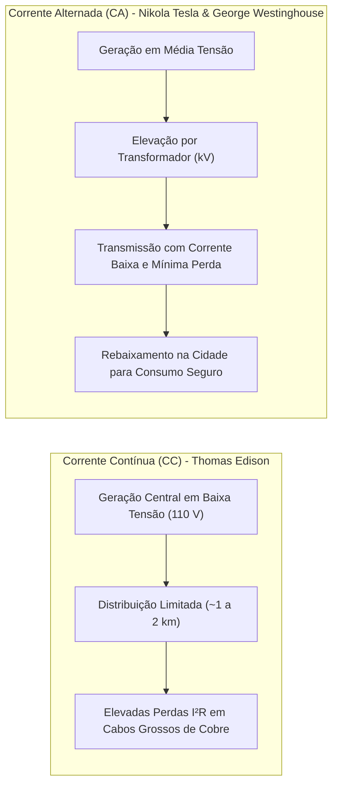
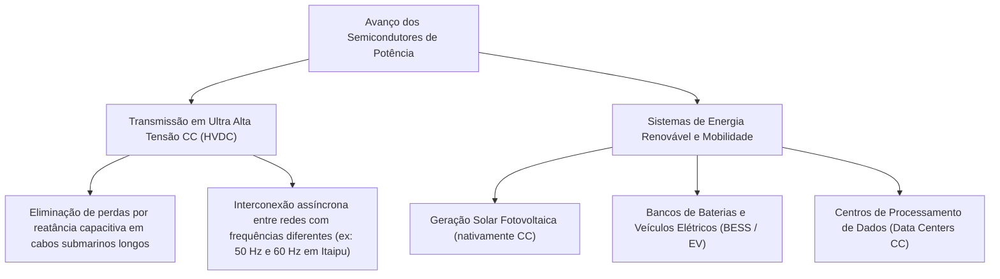

# Capítulo 2: A Guerra das Correntes e a Evolução Histórica dos Conversores

A arquitetura dos sistemas elétricos modernos é resultado direto da **Guerra das Correntes** travada no final do século XIX, um dos maiores debates tecnológicos e econômicos da história da engenharia.

---

## 1. O Conflito Histórico: CC vs. CA

### 1.1 Os Personagens Centrais
* **Thomas Edison:** Defensor ferrenho da Corrente Contínua (CC). Edison desenvolveu a lâmpada incandescente comercial e estabeleceu usinas térmicas a vapor centrais (como a pioneira *Pearl Street Station* em Nova York, 1882). Por não dispor de tecnologia estática para transformar níveis de tensão contínua na época, a energia precisava ser gerada e distribuída na mesma tensão de consumo final ($110\text{ V}$), exigindo uma usina a cada quilômetro.
* **Nikola Tesla e George Westinghouse:** Defensores da Corrente Alternada (CA). Tesla patenteou o sistema polifásico de geração alternada e o motor de indução CA trifásico. Westinghouse adquiriu as patentes de Tesla e investiu no transformador de potência desenvolvido por William Stanley, viabilizando o transporte de energia a distâncias continentais.

---

## 2. Marcos Decisivos e a Vitória da CA

1. **A Exposição Mundial de Chicago (1893):**
   Westinghouse venceu a concorrência para iluminar a Feira de Chicago com sistema CA de Tesla, demonstrando publicamente a confiabilidade, brilho e segurança da tecnologia com mais de 100 mil lâmpadas.
2. **O Projeto Hidrelétrico das Cataratas do Niágara (1895):**
   A primeira grande usina hidrelétrica do planeta utilizou geradores alternadores bifásicos de Tesla para transmitir eletricidade por mais de $35\text{ km}$ até a cidade de Buffalo com altíssima eficiência.

---

## 3. O Renascimento da Corrente Contínua na Eletrônica de Potência Moderna

A vitória da Corrente Alternada no século XIX ocorreu porque **não existiam chaves semicondutoras de potência** capazes de elevar ou rebaixar tensões contínuas sem o uso de volumosos conjuntos motor-gerador rotativos mecânicos.

Com o advento dos tiristores e transistores de potência a partir da década de 1950, a Corrente Contínua ressurgiu como a solução mais eficiente para duas grandes fronteiras da engenharia moderna:

> [!NOTE] A Síntese Tecnológica Atual:
> Hoje, os sistemas de energia não são exclusivos: a Corrente Alternada continua sendo o padrão para a malha de distribuição em rede, enquanto a Eletrônica de Potência atua como a interface universal que conecta cargas e geradores em CC e CA com rendimentos superiores a $98\%$.
