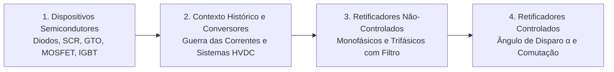

# TE341 - Eletrônica de Potência I

**Período/Ano:** 2° Semestre/2026  
**Departamento:** Engenharia Elétrica - UFPR  
**Links da Disciplina:**
* 📁 [Drive da disciplina](https://drive.google.com/drive/folders/12xt_W_yrEevCZNvqY4lCGQoqjSBvQT8X?usp=drive_link)
* 📝 [Listas e Exercícios Resolvidos](Listas%20Resolvidas.md)

---

## 📚 Ementa e Conteúdo Programático

A disciplina de Eletrônica de Potência I estuda os princípios fundamentais do chaveamento de energia, as características estáticas e dinâmicas dos dispositivos semicondutores de potência (diodos, tiristores, transistores BJT, MOSFET e IGBT), e a topologia e análise de circuitos conversores CA-CC (retificadores monofásicos e trifásicos não-controlados e controlados).

---

## 📑 Módulos Teóricos

### [Capítulo 1: Dispositivos Semicondutores de Potência e Comutação](Capítulo%201%20Dispositivos%20Semicondutores%20de%20Potência.md)
* Classificação: chaves não controladas, semicontroladas e totalmente controladas.
* A família dos tiristores (SCR, TRIAC, GTO, IGCT, MTO, ETO, LASCR): mecanismos de disparo e bloqueio.
* Transistores de potência (MOSFET vs. IGBT): critérios de seleção por tensão, corrente e frequência.
* Perdas de potência: perdas por condução média ($P_{\text{on}}$) e perdas por chaveamento dinâmico ($P_{\text{sw}}$).

### [Capítulo 2: A Guerra das Correntes e Evolução dos Conversores](Capítulo%202%20A%20Guerra%20das%20Correntes%20e%20Conversores.md)
* A disputa tecnológica e comercial entre Thomas Edison (CC) e Nikola Tesla / George Westinghouse (CA).
* Marcos da vitória da Corrente Alternada no século XIX: Feira de Chicago (1893) e Usina de Niágara (1895).
* O renascimento moderno da Corrente Contínua através da eletrônica de potência: transmissão em corrente contínua em alta tensão (HVDC), fontes renováveis (solar) e mobilidade elétrica.

---

## 📂 Materiais de Apoio e Exercícios
* [Listas Resolvidas](Listas%20Resolvidas.md): Resolução comentada de exercícios sobre diodos e semicondutores.