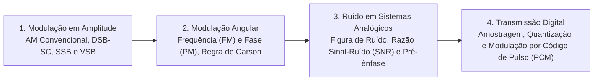

# TE342 - Fundamentos de Comunicação

**Semestre:** 6º Semestre  
**Carga horária:** 60 h  
**Departamento:** Engenharia Elétrica - UFPR  
**Materiais de Apoio:** [Listas Resolvidas](Listas%20Resolvidas.md)

---

## 📚 Visão Geral da Disciplina

Fundamentos de Comunicação cobre a análise dos sistemas analógicos e digitais de transmissão de informação: modulação em amplitude (AM-DSB, AM-DSB-SC, AM-SSB), modulação angular (FM e PM), desempenho na presença de ruído térmico aditivo gaussiano (AWGN), teorema da amostragem e técnicas de modulação por pulsos (PAM, PWM, PCM).

---

## 📑 Principais Tópicos Teóricos

### 1. Modulação em Amplitude (AM-DSB)
Sinal modulado no tempo:

$$
s(t) = A_c [1 + m(t)] \cos(2\pi f_c t)
$$
* Se $m(t) = \mu \cos(2\pi f_m t)$, o índice de modulação $\mu$ deve obedecer $\mu \le 1$ ($100\%$) para permitir demodulação não coerente simples por detector de envoltória.
* A largura de banda de transmissão é $B_{\text{AM}} = 2 f_m$.

### 2. Modulação em Frequência (FM)
O sinal de mensagem $m(t)$ varia a frequência instantânea da portadora:

$$
s(t) = A_c \cos\left(2\pi f_c t + 2\pi k_f \int_0^t m(\tau) d\tau \right)
$$
* **Regra de Carson para Largura de Banda do FM:**
  $$
  B_{\text{FM}} \approx 2 (\Delta f + f_m) = 2 f_m (\beta + 1)
  $$
  onde $\beta = \frac{\Delta f}{f_m}$ é o índice de modulação e $\Delta f = k_f A_m$ é o desvio de frequência de pico.
