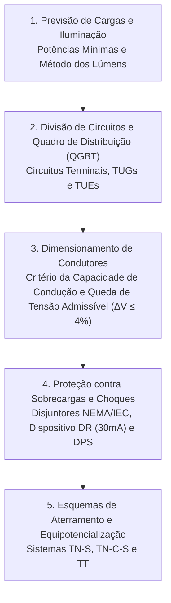

# TE344 - Instalações Elétricas Prediais e Industriais I

**Semestre:** 6º Semestre  
**Carga horária:** 90 h  
**Departamento:** Engenharia Elétrica - UFPR  

---

## 📚 Visão Geral da Disciplina

Estuda o projeto, especificação e dimensionamento de instalações elétricas de baixa tensão em conformidade rigorosa com as normas da ABNT (**NBR 5410** para instalações de baixa tensão e **NBR 5413 / ISO 8995** para iluminação). Abrange previsão de cargas, divisão de circuitos, dimensionamento de condutores (por capacidade de corrente e queda de tensão), dispositivos de proteção (disjuntores termomagnéticos e DR), aterramento (esquemas TN-S, TN-C, TT) e correção do fator de potência.

---

## 📑 Principais Tópicos Teóricos

### 1. Dimensionamento de Condutores (NBR 5410)
O condutor deve satisfazer simultaneamente a três critérios:
1. **Critério da Seção Mínima:** $1{,}5\text{ mm}^2$ para circuitos de iluminação e $2{,}5\text{ mm}^2$ para tomadas (TUG/TUE).
2. **Critério da Capacidade de Condução de Corrente:**
   $$
   I_z' = \frac{I_b}{f_c \cdot f_t}
   $$
   onde $I_b$ é a corrente de projeto, $f_c$ é o fator de agrupamento e $f_t$ é o fator de temperatura.
3. **Critério da Queda de Tensão:**
   A queda de tensão acumulada até o ponto terminal não deve exceder $4\%$:
   $$
   \Delta V = \frac{2 \cdot L \cdot I_b \cdot (r \cos\varphi + x \operatorname{sen}\varphi)}{V_n} \times 100 \le 4\%
   $$

### 2. Proteção contra Choques Elétricos
* **Dispositivo Diferencial-Residual (DR):** Obrigatório em áreas molhadas com sensibilidade nominal $\Delta I_n \le 30\text{ mA}$.
